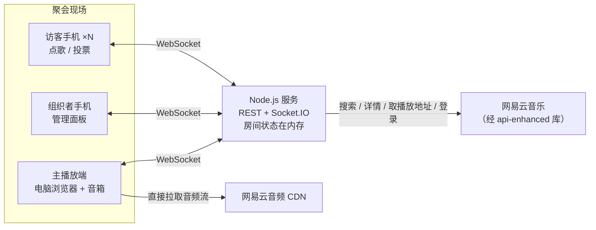
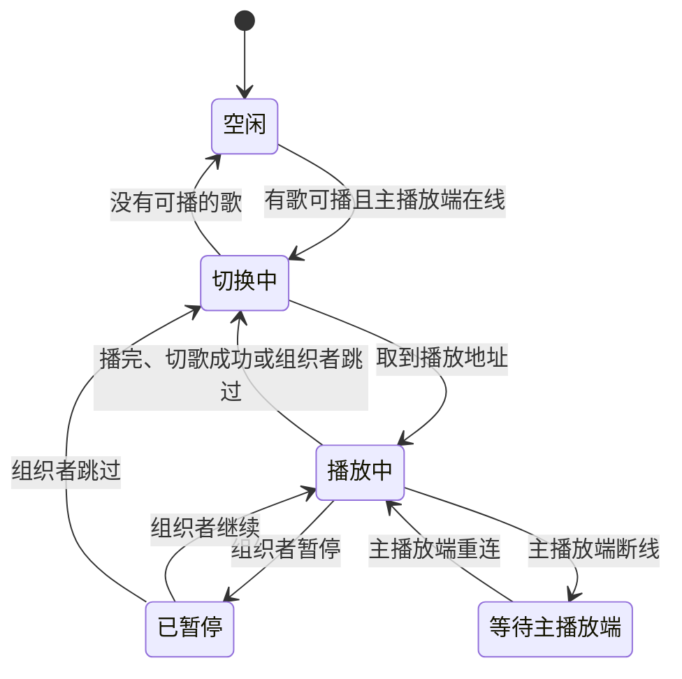
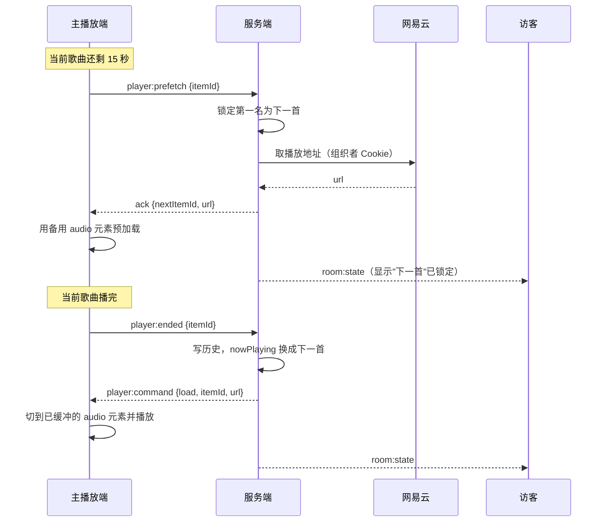

# 聚会音乐播放器 · 架构设计（Agent 版）

| 项目 | 内容 |
|---|---|
| 编写者 | AI Agent（Claude 模型），独立完成 |
| 依据材料 | `文档/如何解决聚会音乐的选择问题.md`（选题与目标）；`文档/2026年高中信息技术实践测试题目B.pdf`（测试要求）；问卷星问卷题目及《聚会音乐选择调查-默认报告.xlsx》（5 份有效答卷） |
| 未参考 | `文档/架构设计/人类/架构.md`，按要求没有打开 |
| 外部核实 | 网易云音乐接口社区库的维护现状（见 3.7 节） |

## 1. 需求梳理

### 1.1 角色

| 角色 | 说明 |
|---|---|
| 组织者 | 创建房间，拥有全部权限。通常同时用两台设备：主播放端（接音箱的电脑）和自己的手机 |
| 访客 | 用邀请码、口令和昵称加入；点歌、投票、请求切歌；可选登录网易云，从自己的歌单选歌 |
| 主播放端 | 一个设备角色：房间里唯一负责出声的浏览器页面，由组织者打开，同一时刻只有一个 |

### 1.2 功能需求

| 编号 | 需求 | 来源 |
|---|---|---|
| F1 | 创建房间，自动生成邀请码与口令，显示加入二维码；组织者可关闭房间 | 选题目标 |
| F2 | 访客凭邀请码、口令、昵称加入；刷新页面或手机锁屏后身份不丢 | 选题目标 |
| F3 | 搜索网易云曲库并点歌，受每人配额限制；同一首歌被多人点时合并计数 | 选题目标；问卷第 3、4 题 |
| F4 | 对队列中的歌点赞、点踩或取消 | 选题目标 |
| F5 | 队列按投票、点歌人次、提交顺序、热门度、时长五个因素加权动态排序，并展示得分构成 | 问卷第 3 题 |
| F6 | 主播放端连续播放，一首结束自动接下一首 | 选题目标 |
| F7 | 三种切歌模式：任何人、一半以上、所有人；组织者随时可强制切歌 | 选题目标；问卷第 5 题 |
| F8 | 组织者完全控制：暂停、继续、跳过、调进度、调音量、删除、置顶、改设置、踢人、重置口令 | 选题目标 |
| F9 | 扩展：访客登录网易云，从收藏和歌单选歌；组织者登录会员账号，播放会员歌曲 | 选题目标 |

### 1.3 非功能需求

- **规模：** 单房间不超过 30 人、队列不超过 200 首；一个服务实例同时承载约 20 个房间。
- **实时性：** 局域网内，一个人的操作 0.5 秒内出现在所有人的屏幕上。
- **易用：** 访客不装 App、不注册账号，手机浏览器扫码即用。
- **恢复：** 手机锁屏、切后台、断网后自动恢复；服务重启后房间和队列能恢复（网易云登录需重新扫码）。
- **可调：** 排序权重和各项阈值都是配置项，试用后不改代码就能调整。
- **安全：** 令牌、口令、网易云 Cookie 不泄露；所有权限在服务端校验。

### 1.4 问卷结论与设计决策

问卷共 5 份有效答卷，样本小，下表的数值只作为初始默认值，小组试用（选题步骤 7）后再校准。

| 问卷结果 | 设计决策 |
|---|---|
| 第 1 题：现在常用"随机歌单"（60%）和"每人选一首"（60%） | 核心机制是"每人点歌 + 投票排序"；另提供可选的"兜底歌单"，队列空了就从里面随机播放 |
| 第 2 题：最担心"有人为了自己的歌先放而恶意点踩"（60%），其次是"热门歌权重太高"（20%） | 同一个人点踩越多，每一票的分量越小（见 3.4.3）；热门度权重按问卷排名保持中等，并对外展示得分构成 |
| 第 3 题综合得分：投票 4、点歌人次 2.6、提交顺序 2.6、热门度 2.4、时长 1 | 归一化后作为默认权重：0.32 / 0.21 / 0.21 / 0.19 / 0.08 |
| 第 4 题：80% 选"不限制" | 默认不限每人点歌数，组织者可设上限 |
| 第 5 题：60% 选"一半以上的人想切才切" | 默认切歌模式为"一半以上"，按"至少一半"计算（小组已确认）；三种模式都实现，组织者可切换 |
| 第 1、2、5 题各有 1 人选了"其他" | 导出报告里没有填写内容，需要到问卷星后台查看，确认有没有遗漏的需求 |

## 2. 总体架构

### 2.1 部署形态



**模式 A：局域网（推荐）。** 服务跑在组织者的电脑上，主播放端就是这台电脑的浏览器。访客连同一个 Wi-Fi，扫码访问 `http://<电脑局域网 IP>:3000`。好处：零成本、延迟低；请求网易云时出口是普通家庭宽带 IP，与正常用户无异，不容易触发风控或地区限制。

**模式 B：云服务器。** 服务部署在国内云服务器上，用 Caddy 反向代理并自动签发 HTTPS 证书，访客用流量也能加入。海外服务器取网易云播放地址时，很多歌会因版权地区限制拿不到，不建议使用。

前后端是两个独立的包，只通过 REST 和 Socket.IO 接口通信。生产环境由后端顺带托管前端构建产物，局域网模式一条命令就能启动；也可以把前端单独部署到静态托管或 Nginx。

### 2.2 技术选型

| 层 | 选择 | 理由 |
|---|---|---|
| 语言 | TypeScript（前后端统一） | 前后端共用一份类型定义，接口对不上会在编译期报错 |
| 运行时 | Node.js 22 LTS | 选题指定 Node.js；22 是当前长期支持版本 |
| HTTP | Express 5 | 资料最多，组员上手快 |
| 实时通信 | Socket.IO 4 | 自带断线重连、房间广播和 ack 确认，适合"一个人操作，所有人看到" |
| 校验 | zod | 前后端共用同一套输入校验规则 |
| 音乐接口 | `@neteasecloudmusicapienhanced/api` | 社区维护的网易云接口库，在进程内直接调用函数，不用另起一个服务 |
| 存储 | 内存 + JSON 快照文件 | 房间是临时的，一场聚会几个小时就结束，不需要数据库 |
| 前端框架 | Vue 3 + Vite + Vue Router | 选题指定 Vue |
| 前端状态 | Pinia | Vue 官方推荐的状态管理 |
| UI 组件 | Vant 4 | 移动端组件库，访客主要用手机 |
| 二维码 | `qrcode` | 生成加入二维码、网易云登录二维码 |
| 日志 | pino | 支持字段脱敏，保证 Cookie 和令牌不进日志 |
| 测试 | Vitest；Playwright（可选） | 与 Vite 同一套生态 |
| 工程 | npm workspaces 单仓 | Node 自带，不用额外装工具 |

### 2.3 关键架构决策

1. **服务端说了算。** 客户端只发送"意图"（我要点这首、我赞这首），校验、修改和排序全部在服务端完成，然后广播结果。投票、配额和切歌阈值必须对所有人一致，也不能靠改前端代码绕过。
2. **只有一个设备出声。** 主播放端负责播放，其他设备只显示进度。在浏览器里让多台手机精确同步播放很难，聚会也只需要一个音箱。
3. **全量快照同步。** 每次状态变化后，服务端给房间里每个连接推送一份完整的房间快照（按身份裁剪），带递增版本号。单个房间的数据只有几十 KB，全量推送比增量补丁简单得多，断线重连也只需重新拉一次。
4. **规则写成纯函数。** 排序、切歌判定和配额检查都是"输入房间状态和当前时间，输出结果"的纯函数，方便单元测试，也方便试用后调参。
5. **隔离第三方接口。** 网易云接口是非官方的，随时可能变动。所有调用都收在 `music/` 模块里，对外只暴露项目自己的 `Track` 类型；接口变了只改这一处。
6. **单进程。** 目标规模下单进程完全够用。以后要多实例，再引入 Redis 和 Socket.IO 的 Redis 适配器，领域层不用动。

## 3. 后端设计

### 3.1 目录结构

```text
party-music-player/
├─ package.json                 # npm workspaces 根配置
├─ packages/
│  ├─ shared/                   # 前后端共用
│  │  └─ src/
│  │     ├─ types.ts            # Track、RoomSnapshot 等接口类型
│  │     ├─ events.ts           # Socket.IO 事件名与载荷类型
│  │     ├─ schemas.ts          # zod 输入校验
│  │     └─ errors.ts           # 错误码
│  ├─ server/
│  │  └─ src/
│  │     ├─ index.ts            # 启动；打印局域网地址
│  │     ├─ config.ts           # 环境变量与默认参数
│  │     ├─ http/               # Express 路由与中间件（鉴权、限流）
│  │     ├─ realtime/           # Socket.IO 网关、事件处理、广播调度
│  │     ├─ domain/             # 纯函数，不做任何 I/O
│  │     │  ├─ room.ts          # 房间聚合：点歌、撤回、投票、踢人
│  │     │  ├─ ranking.ts       # 排序算法
│  │     │  ├─ skip.ts          # 切歌判定
│  │     │  └─ presence.ts      # 在场成员计算
│  │     ├─ services/           # 编排层：调用领域函数和外部依赖
│  │     │  ├─ roomService.ts
│  │     │  ├─ playbackService.ts
│  │     │  └─ authService.ts
│  │     ├─ music/              # 网易云接入（唯一接触第三方库的地方）
│  │     │  ├─ neteaseClient.ts
│  │     │  ├─ credentialVault.ts  # 网易云 Cookie，只放内存
│  │     │  └─ cache.ts
│  │     └─ infra/
│  │        ├─ store.ts         # 内存房间仓库 + 快照读写
│  │        ├─ tokens.ts        # 随机令牌生成与哈希
│  │        └─ logger.ts        # pino，自动脱敏
│  └─ web/
│     └─ src/ ...               # 见第 5 章
└─ data/                        # 运行时快照，不提交到 git
```

依赖方向只能是 `http`/`realtime` → `services` → `domain`/`music`/`infra`，`domain` 不依赖其他任何层。

### 3.2 领域模型

```ts
type Role = 'host' | 'guest'
type SkipMode = 'anyone' | 'half' | 'all'
type Vote = 1 | -1

interface Room {
  id: string                         // 内部 UUID
  code: string                       // 6 位数字邀请码，在活跃房间中唯一
  passcode: string                   // 4 位数字口令，只有组织者能看到
  status: 'open' | 'closed'
  createdAt: number
  lastActiveAt: number
  settings: RoomSettings
  members: Map<string, Member>
  queue: Map<string, QueueItem>      // 待播歌曲
  upNextId: string | null            // 已锁定的下一首（见 3.4.5）
  nowPlaying: NowPlaying | null
  history: PlayedItem[]              // 最近 200 条
  playerSocketId: string | null      // 当前主播放端的连接
  version: number                    // 每次修改 +1
}

interface RoomSettings {
  quotaPerMember: number | null      // 每人队列中最多几首待播；null = 不限（默认）
  skipMode: SkipMode                 // 默认 'half'
  weights: { vote: number; adds: number; order: number; popularity: number; duration: number }
  allowTrialTracks: boolean          // 是否允许只能试听的歌，默认 false
  audioLevel: 'standard' | 'exhigh' | 'lossless'
  fallbackPlaylistId: string | null  // 兜底歌单
}

interface Member {
  id: string
  role: Role
  nickname: string
  tokenHashes: string[]              // 组织者可能有多台设备，每台一个令牌
  lastSeenAt: number
  online: boolean                    // 至少有一条 Socket 连接
  left: boolean                      // 主动点了"离开房间"
  netease: { userId: number; nickname: string } | null  // Cookie 不放这里，见 3.7.4
}

interface Track {
  source: 'netease'
  sourceId: string
  title: string
  artists: string[]
  album: string
  coverUrl: string
  durationMs: number
  popularity: number | null          // 0–100，取自网易云歌曲详情的 pop 字段
  playability: 'full' | 'trial' | 'unavailable'  // 用组织者账号实测的结果
}

interface QueueItem {
  id: string                         // 每次入队生成新 id；查重用 source + sourceId
  track: Track
  addedBy: string[]                  // 点过这首歌的成员 id，按先后顺序
  firstAddedAt: number
  votes: Map<string, Vote>           // memberId → 赞或踩
  pinnedAt: number | null            // 组织者置顶的时间
}

interface NowPlaying {
  item: QueueItem
  positionMs: number                 // 主播放端最近一次上报的进度
  reportedAt: number
  paused: boolean
  skipVotes: Set<string>             // 请求切歌的 memberId
}

interface PlayedItem {
  track: Track
  addedBy: string[]
  endedAt: number
  reason: 'finished' | 'skipped' | 'removed' | 'error'
}
```

### 3.3 房间与身份

#### 3.3.1 创建房间

1. 组织者在主播放端打开首页，点"创建房间"，填昵称。
2. 服务端生成 6 位邀请码（与活跃房间不重复）、4 位口令，以及组织者令牌（`crypto.randomBytes(32)`，base64url 编码）。服务端只存令牌的 SHA-256 哈希。
3. 返回邀请码、口令和令牌。前端把令牌存进 `localStorage`，进入主播放页。

**在手机上管理：** 主播放页可以显示一个"用手机管理"二维码，里面是一次性票据（2 分钟有效，用一次就作废）。组织者用手机扫码后，服务端为同一个组织者成员签发一个新令牌。二维码里不放长期令牌，被人拍到照片也没关系。

#### 3.3.2 加入房间

1. 访客扫加入二维码，打开 `/r/<邀请码>`；也可以在首页手动输入邀请码。二维码里只有邀请码，口令由组织者口头告知，或在大屏上点按钮显示。这样即使二维码截图被转发出去，只拿到截图的人也进不来。
2. 访客输入口令和昵称后提交。服务端用 `crypto.timingSafeEqual` 比对口令，通过后创建 `Member`，返回成员令牌。
3. 前端把令牌按邀请码存进 `localStorage`，并在 Socket.IO 握手时带上。刷新页面或锁屏重连时用同一个令牌，身份、配额和投票都保留。

**防暴力猜口令：** 同一 IP 每分钟最多尝试 10 次；同一房间 10 分钟内失败 30 次后，暂停该房间的新加入 2 分钟，并通知组织者。

**重置口令：** 只影响之后的加入，已经在房间里的人不受影响。

**踢人：** 作废这个成员的令牌，撤销其所有投票和点歌（一首歌如果只有这个人点过，就从队列里删掉）。被踢的人知道口令的话还能重新加入，组织者可以踢人后再重置口令。

**已知局限：** 一个人开几个无痕窗口就能有几个身份。系统不做设备指纹（既不可靠，又涉及隐私），而是让组织者能看到成员列表并踢人。

#### 3.3.3 在场成员

手机锁屏或切到后台后，Socket 连接会频繁断开。如果只按"当前在线"统计人数，阈值会忽高忽低。因此定义：

> **在场成员**：没有点"离开房间"，并且当前在线，或最近 10 分钟内有过连接。在场人数记为 P，最小取 1。

投票归一化和切歌阈值都用 P。不在场成员的投票保留但不计入，回来后自动恢复。

#### 3.3.4 点歌规则

- 配额只统计"自己点的、还在队列里待播"的歌。歌播完或被删后名额就还回来；组织者不受配额限制。
- 点一首已经在队列里的歌，就把自己加入这首歌的 `addedBy`，占一个名额，不会产生重复条目。
- 正在播放的歌不能再点。已经播过的歌可以再点，作为新条目入队。
- 撤回点歌：把自己从 `addedBy` 中移除；如果没有其他人点过，这首歌就从队列中删除。

### 3.4 排序算法

#### 3.4.1 总分

每首待播歌曲的总分在 0 到 100 之间：

```text
总分 = 100 × (w投票·s投票 + w人次·s人次 + w顺序·s顺序 + w热门·s热门 + w时长·s时长)
```

默认权重来自问卷第 3 题的综合得分（4 / 2.6 / 2.6 / 2.4 / 1），存原始比例，运行时按总和归一化，约为 0.32 / 0.21 / 0.21 / 0.19 / 0.08。组织者在设置里改的也是比例。

#### 3.4.2 五个因素

每个因素都先换算成 0 到 1 之间的分数 s：

| 因素 | 计算方式 | 直观含义 |
|---|---|---|
| 投票 | `clamp(0.5 + V / P, 0, 1)`，V 是加权净票数（见 3.4.3） | 没人投票时 0.5；净赞达到在场人数一半时满分，净踩达到一半时为 0 |
| 点歌人次 | `min(1, 2n / P)`，n 是点过这首歌的人数 | 在场的人有一半都点了这首歌时满分 |
| 提交顺序 | `min(1, 已等待分钟数 / 60)` | 等得越久分越高，60 分钟封顶 |
| 热门度 | `pop / 100`，没有数据时取 0.5 | 网易云歌曲详情里的热度值 |
| 时长 | 2 分钟及以下得 1，7 分钟及以上得 0，中间线性递减 | 短歌优先 |

**选这些换算方式的原因：** 一个因素的实际影响等于"权重 × 这个因素在队列里的分数差距"。如果某个因素的分数总在 0.45 到 0.55 之间晃，权重再高也起不了作用。上面的换算让常见情况能覆盖 0 到 1 的大部分区间，下面 3.4.4 的影响表可以检验这一点。提交顺序用"等待时长"而不是"排第几"，因为排名会随队列长短变化，等待时长不会；它还起到防饿死的作用，被踩的歌等得够久也能播到。

#### 3.4.3 防恶意点踩

问卷里最多人担心"有人为了自己的歌先放，恶意点踩别人的歌"。对应三条规则：

**1. 踩得越多，每票越轻。** 某成员当前在队列里一共踩了 k 首歌，这个成员的每个踩按 `1/√k` 计入：

| 踩了几首 | 每票分量 | 合计分量 |
|---|---|---|
| 1 | 1.00 | 1.00 |
| 2 | 0.71 | 1.41 |
| 4 | 0.50 | 2.00 |
| 9 | 0.33 | 3.00 |

只踩一首真心不想听的歌，分量和一个赞一样；见谁踩谁，影响力就被摊薄了。赞不做摊薄，因为多点赞不会损害别人。

加权净票数 `V = 在场成员的赞数 − Σ 在场成员每个踩的分量`。

**2. 不能给自己点的歌投票。** 先投了票再点这首歌，原来的投票作废。

**3. 踩只能推迟，不能埋掉。** 提交顺序因素会随等待时间上涨。10 人房间里，其他条件相同时，一首被 3 个人各踩一次的歌，大约多等 28 分钟，就能和一首刚点的中性歌排在一起。

此外，组织者能看到谁踩了哪首歌，访客只能看到赞和踩的数量。

#### 3.4.4 各因素的实际影响

按默认权重计算，各项变化让总分变动多少：

| 变化 | P = 5 | P = 10 | P = 20 |
|---|---|---|---|
| 多 1 个赞（或少 1 个踩） | +6.3 | +3.2 | +1.6 |
| 多 1 个人点这首歌 | +8.3 | +4.1 | +2.1 |
| 多等 10 分钟 | +3.4 | +3.4 | +3.4 |
| 热度高 10 点 | +1.9 | +1.9 | +1.9 |
| 时长短 1 分钟 | +1.6 | +1.6 | +1.6 |

在 10 人房间里，1 个赞约等于多等 9 分钟。房间越大，每个人的一票越轻，这是有意为之。需要注意热门度：热度 95 的爆款和热度 40 的冷门歌相差 10.5 分，约等于 3 个赞。如果试用时发现热门歌总排在前面，首先调低热门度权重。

#### 3.4.5 最终顺序与"下一首锁定"

队列按以下规则排序：

1. 置顶的歌排最前，按置顶时间先后。
2. 其余按总分从高到低。
3. 总分相同，先点的排前面。

**下一首锁定：** 当前歌曲还剩 15 秒时，主播放端发送 `player:prefetch`。服务端把此刻排第一的歌锁定为"下一首"（`upNextId`），这首歌不再参与重排，同时返回它的播放地址，供主播放端预加载。这样做有两个好处：最后几秒的投票不会让即将播放的歌被挤掉；主播放端可以提前缓冲，切歌时没有空档。组织者仍可手动更换或删除下一首，此时解除锁定、重新选。如果没收到 `prefetch`（比如被切歌），就在切换时直接取当时的第一名。

**何时重算：** 点歌、撤回、投票、成员进出和改设置后立即重算；另外每 60 秒重算一次，因为等待时长和在场人数会随时间变化。有变化才广播。200 首歌的队列重算一次不到 1 毫秒。

快照里带每首歌的得分构成，前端点开就能看到这首歌为什么排在这里。

### 3.5 切歌规则

| 模式 | 触发条件 |
|---|---|
| 任何人（`anyone`） | 1 个人请求即切；为防捣乱，同一个人 30 秒内只能触发一次 |
| 一半以上（`half`，默认） | 请求切歌的在场人数 ≥ `⌈P/2⌉`，即至少一半：5 人需要 3 票，6 人需要 3 票 |
| 所有人（`all`） | 请求切歌的在场人数 = P |
| 组织者 | 随时强制切歌，不受模式限制 |

- 切歌请求必须带上当前歌曲的 id。服务端发现 id 已经过期（歌刚好换了），就直接忽略，避免把下一首误切掉。
- 可以撤回切歌请求。换歌后所有请求清空。
- 在场人数变化时重新判断。比如有人离开后剩下的请求已经达到一半，就立即切歌。
- 界面显示实时进度，例如"切歌 2/3"。

### 3.6 播放控制

#### 3.6.1 状态机



**"切换中"的步骤：**

1. 把刚结束的歌写入历史，记录结束原因。
2. 取下一首：优先取已锁定的下一首，否则取队列第一名。队列为空时，如果设置了兜底歌单，就从中随机取一首（避开最近 20 首播过的歌）。
3. 用组织者的网易云 Cookie 取播放地址。失败就把这首记为 `error` 写入历史，接着试下一首；连续失败 3 首就停下，回到空闲并通知组织者。
4. 更新 `nowPlaying`，版本号加 1，广播快照，只给主播放端发送 `player:command`（`load`）。

#### 3.6.2 正常换歌时序



#### 3.6.3 主播放端约定

- **只有一个主播放端。** 只有组织者的设备能发 `player:claim`。新设备认领后，旧设备收到 `player:released`，退回普通管理界面。
- **只认当前主播放端。** 只处理当前主播放端发来的 `player:ended`、`player:progress` 和 `player:error`。`ended` 必须带 `itemId`，与当前歌曲不一致就忽略，所以重复上报或旧设备上报都不会连跳两首。
- **进度同步。** 主播放端每 5 秒上报一次进度，这本身不触发广播。其他设备用 `positionMs + (serverNow − reportedAt)` 自己推算进度条；快照里带 `serverNow`，用来抵消手机时钟误差。
- **播放地址过期。** 网易云的播放地址有有效期。播放出错时，主播放端发 `player:error`，服务端重新取地址，从出错的位置继续；同一首重试 1 次仍失败就跳过。
- **自动播放限制。** 浏览器不允许页面在用户点击前出声。主播放页进入时显示"开始播放"按钮，点一次就同时解锁两个 audio 元素（一个播当前曲，一个预加载下一首，两者交替使用）。
- **防息屏。** 用 Screen Wake Lock API 防止主播放端息屏。这个接口要求安全上下文；局域网模式下主播放端访问的是 `localhost`，满足要求。

### 3.7 网易云音乐接入

#### 3.7.1 依赖选择

最早的社区库 `NeteaseCloudMusicApi`（Binaryify）的 GitHub 仓库已经不再更新。社区在此基础上继续维护了 [api-enhanced](https://github.com/NeteaseCloudMusicApiEnhanced/api-enhanced)，npm 包名是 `@neteasecloudmusicapienhanced/api`。它支持在 Node.js 里直接 `require` 调用，函数返回 Promise，不用单独起 HTTP 服务。本项目选用这个包，并在 `package.json` 里锁定具体版本，不自动升级。

这是非官方的逆向接口，登录类接口历史上多次失效，例如二维码扫码后状态一直停在"授权中"（见原仓库 [issue #1744](https://github.com/Binaryify/NeteaseCloudMusicApi/issues/1744)）。所以里程碑 M3 的第一步，是先用一个小脚本验证搜索、取播放地址和扫码登录在当前版本下都能用（见第 8 章）。

#### 3.7.2 适配接口

`music/neteaseClient.ts` 对内只暴露下面这些方法，返回值都是项目自己的类型：

```ts
interface MusicProvider {
  search(keyword: string, page: number): Promise<Track[]>         // cloudsearch
  getTracks(ids: string[]): Promise<Track[]>                      // song_detail，含 pop 热度
  getPlayUrl(id: string, level: AudioLevel, cookie?: string)
    : Promise<{ url: string | null; trialOnly: boolean }>         // song_url_v1
  getUserPlaylists(cookie: string): Promise<PlaylistSummary[]>    // user_playlist；第一个是"我喜欢的音乐"
  getPlaylistTracks(id: string, page: number, cookie?: string)
    : Promise<Track[]>                                            // playlist_track_all
  createLoginQr(): Promise<{ key: string; qrImage: string }>      // login_qr_key + login_qr_create
  checkLoginQr(key: string): Promise<QrStatus>                    // login_qr_check
  getAccount(cookie: string): Promise<NeteaseAccount>             // user_account，含是否会员
}
```

- **缓存：** 搜索结果 5 分钟、歌曲详情 1 小时、歌单 5 分钟，用 LRU 缓存。
- **限流：** 对网易云的并发请求最多 5 个；每个成员每分钟最多搜索 20 次，避免触发网易云的反爬。
- **可播放性检查：** 点歌时，服务端用组织者的 Cookie 实际取一次播放地址。拿不到地址记为 `unavailable`，直接拒绝点歌并提示原因；只给试听片段的记为 `trial`，默认拒绝（`allowTrialTracks` 打开时可以点）；其他记为 `full`。结果缓存 10 分钟。组织者登录或退出时，整个队列重新检查一遍，因为会员身份会改变结果。

#### 3.7.3 组织者登录（会员播放）

1. 组织者在主播放端点"登录网易云"，服务端调 `createLoginQr` 生成二维码。
2. 组织者用手机网易云 App 扫码确认。前端每 2 秒轮询一次状态：800 已过期、801 等待扫码、802 已扫码待确认、803 登录成功。
3. 登录成功后，Cookie 存进 `credentialVault`，之后所有取播放地址的请求都带上它，会员歌曲可以完整播放，音质按 `audioLevel` 取。
4. 局域网模式下，组织者可以把 Cookie 写进本机的环境变量 `NETEASE_HOST_COOKIE`，服务重启后不用重新扫码。这个值只在组织者自己的电脑上，不进仓库。

#### 3.7.4 访客从自己的歌单选歌

访客用的是手机，没法用同一台手机扫自己屏幕上的二维码，所以提供两种方式：

| 方式 | 流程 | 适用 |
|---|---|---|
| 粘贴歌单链接（推荐） | 访客在网易云 App 里"分享 → 复制链接"，粘贴到本系统；服务端解析出歌单 id，不带 Cookie 读取 | 公开歌单；不需要交出任何凭据 |
| 扫码登录 | 访客点"登录网易云 → 显示到大屏"，大屏上弹出带访客昵称的登录二维码（2 分钟有效），访客用自己手机的网易云 App 扫码确认 | 私密歌单、"我喜欢的音乐" |

不提供手机号加短信验证码登录：这个接口在非官方库里最容易触发风控，而且服务端要经手手机号。

**凭据保管：** 访客的 Cookie 只存在 `credentialVault` 这个内存 Map 里（键是房间 id 加成员 id），不写快照、不进日志、不发给任何客户端，只用来读取访客本人的歌单，不用于播放。访客退出登录、被踢、房间关闭或服务重启时删除。登录前，界面提示："你的登录状态只保存在本次聚会的服务器内存里，聚会结束即删除。"

### 3.8 并发、持久化与房间生命周期

**并发：** Node.js 是单线程的，只要一次修改中间没有 `await`，同一房间的修改就不会交错。每个事件处理器都按三步写：

1. 先异步取外部数据（如歌曲详情、可播放性）；
2. 再同步地重新校验并修改状态（`await` 期间状态可能已变，比如配额已经用完）；
3. 最后版本号加 1，安排一次广播。

**幂等：** 投票是"设置为某个值"而不是"切换"，切歌请求存在 Set 里，重复点歌会合并。客户端因重连而重发请求时，结果不变，不需要额外去重。

**广播节流：** 同一房间 150 毫秒内的多次修改合并成一次广播。

**快照：** 状态变化后防抖 2 秒，把所有房间写进 `data/rooms.json`。先写临时文件再重命名，写到一半断电也不会损坏原文件。收到退出信号时立即写一次。快照不含任何 Cookie。启动时读取快照，丢弃已过期的房间；正在播放的歌恢复为暂停状态，停在上次上报的位置。

**房间生命周期：** 出现以下情况之一，房间关闭：组织者点"关闭房间"；所有成员断开超过 2 小时；创建超过 24 小时。关闭时广播 `room:closed`，删除该房间的全部凭据和数据。

## 4. 通信接口

### 4.1 REST

前缀都是 `/api`。需要身份的接口用请求头 `Authorization: Bearer <令牌>`；服务端从令牌哈希反查房间和成员。

| 方法与路径 | 权限 | 用途 |
|---|---|---|
| `POST /rooms` | 任何人（公网部署时需填 `ROOM_CREATE_SECRET`） | 创建房间，返回邀请码、口令、组织者令牌 |
| `GET /rooms/:code` | 任何人 | 查房间是否存在、是否开放（不返回其他信息） |
| `POST /rooms/:code/join` | 任何人，限流 | 凭口令和昵称加入，返回成员令牌 |
| `POST /rooms/:code/host-ticket` | 组织者 | 生成"用手机管理"的一次性票据 |
| `POST /host-ticket/redeem` | 持票据 | 兑换组织者令牌 |
| `GET /server-info` | 组织者 | 返回局域网地址或 `PUBLIC_URL`，用于生成加入二维码 |
| `GET /music/search?q=&page=` | 成员，限流 | 搜索歌曲 |
| `POST /music/playlist/resolve` | 成员 | 解析歌单分享链接，返回歌单 id 和名称 |
| `GET /music/playlists/:id/tracks?page=` | 成员 | 读取歌单曲目（登录了就带上本人的 Cookie） |
| `POST /netease/login/qr` | 成员 | 生成登录二维码；参数 `showOnHost: true` 时推送到大屏 |
| `GET /netease/login/qr/:key` | 成员 | 轮询扫码状态 |
| `GET /netease/me/playlists` | 已登录网易云的成员 | 本人的歌单列表 |
| `POST /netease/logout` | 成员 | 退出网易云登录并删除 Cookie |

点歌、投票、切歌这类修改走 Socket.IO，不走 REST：它们需要按顺序处理并立即广播给全房间，放在同一条连接上最简单。

### 4.2 Socket.IO 事件

令牌在握手时通过 `auth: { token }` 传入，服务端校验后把连接加入房间频道。客户端发出的事件都带 ack 回调，返回 `{ ok: true, data }` 或 `{ ok: false, code }`。

**客户端 → 服务端**

| 事件 | 载荷 | 权限 |
|---|---|---|
| `queue:add` | `{ sourceId }` | 成员 |
| `queue:withdraw` | `{ itemId }` | 点过这首歌的成员 |
| `vote:set` | `{ itemId, vote: 1 \| -1 \| 0 }`，0 表示取消 | 成员，不能投自己点的歌 |
| `skip:request` | `{ itemId, on: boolean }` | 成员 |
| `room:leave` | 无 | 成员 |
| `admin:playback` | `{ action: 'pause' \| 'resume' \| 'skip' \| 'seek' \| 'volume', value? }` | 组织者 |
| `admin:queue` | `{ action: 'remove' \| 'pin' \| 'unpin' \| 'setNext', itemId }` | 组织者 |
| `admin:settings` | `Partial<RoomSettings>` | 组织者 |
| `admin:kick` | `{ memberId }` | 组织者 |
| `admin:resetPasscode` | 无 | 组织者 |
| `admin:close` | 无 | 组织者 |
| `player:claim` | 无 | 组织者设备 |
| `player:prefetch` | `{ itemId }` | 当前主播放端 |
| `player:progress` | `{ itemId, positionMs, paused }` | 当前主播放端 |
| `player:ended` | `{ itemId }` | 当前主播放端 |
| `player:error` | `{ itemId, positionMs, reason }` | 当前主播放端 |

**服务端 → 客户端**

| 事件 | 发给谁 | 内容 |
|---|---|---|
| `room:state` | 每个连接各发一份 | 按身份裁剪的完整快照（见 4.3） |
| `room:notice` | 相关的人 | 提示，例如"切歌成功""你的歌因无法播放被移除" |
| `room:closed` | 全房间 | 房间已关闭 |
| `member:kicked` | 被踢的人 | 断开连接前的通知 |
| `player:command` | 仅主播放端 | `load`（含 url）、`pause`、`resume`、`seek`、`volume` |
| `player:released` | 原主播放端 | 已被其他设备接管 |
| `netease:loginQr` | 仅主播放端 | 在大屏上显示某位访客的登录二维码 |

### 4.3 房间快照

```ts
interface RoomSnapshot {
  version: number
  serverNow: number                    // 用于校正客户端时钟
  room: { code: string; status: 'open' | 'closed'; settings: RoomSettings }
  me: {
    memberId: string
    role: Role
    quotaUsed: number
    quotaLimit: number | null
    netease: { nickname: string } | null
  }
  nowPlaying: {
    item: QueueItemView
    positionMs: number
    reportedAt: number
    paused: boolean
    skip: { count: number; needed: number; mine: boolean }
  } | null
  upNext: QueueItemView | null
  queue: QueueItemView[]               // 已按 3.4.5 排好序
  members: { id: string; nickname: string; role: Role; present: boolean }[]
  host?: {                             // 只有组织者的快照里有
    passcode: string
    votersByItem: Record<string, { up: string[]; down: string[] }>
    neteaseVip: boolean
  }
}

interface QueueItemView {
  id: string
  track: Track
  addedBy: { id: string; nickname: string }[]   // 谁点的歌是公开的
  up: number
  down: number                                  // 只给数量，不暴露投票人
  myVote: 1 | -1 | 0
  mine: boolean                                 // 我是否点过
  score: { total: number; vote: number; adds: number; order: number; popularity: number; duration: number }
}
```

`me`、`myVote` 和 `mine` 因人而异，口令和投票人名单只给组织者，所以服务端为每个连接单独生成快照。一个房间最多 30 人，这点开销可以忽略。客户端收到 `version` 不大于本地版本的快照时直接丢弃。

### 4.4 错误码

错误码定义在 `shared/errors.ts`，前端统一映射成中文提示：

`ROOM_NOT_FOUND`、`ROOM_CLOSED`、`BAD_PASSCODE`、`JOIN_PAUSED`、`RATE_LIMITED`、`UNAUTHORIZED`、`FORBIDDEN`、`QUOTA_EXCEEDED`、`TRACK_UNAVAILABLE`、`TRACK_TRIAL_ONLY`、`ALREADY_PLAYING`、`CANNOT_VOTE_OWN`、`STALE_ITEM`、`NOT_ACTIVE_PLAYER`、`NETEASE_ERROR`、`VALIDATION_FAILED`

## 5. 前端设计

### 5.1 页面与路由

| 路由 | 页面 | 使用者 |
|---|---|---|
| `/` | 首页：创建房间 / 输入邀请码 | 所有人 |
| `/r/:code` | 加入页：输入口令和昵称；已有令牌就直接进房间 | 访客 |
| `/r/:code/room` | 房间页，底部标签：队列、搜索、我的歌单；组织者多一个"管理" | 访客、组织者手机 |
| `/r/:code/host` | 主播放页：大字横屏、封面、进度、队列、加入二维码 | 主播放端 |
| `/host-ticket/:ticket` | 兑换组织者令牌后跳转到房间页 | 组织者手机 |

### 5.2 目录结构

```text
packages/web/src/
├─ api/http.ts            # fetch 封装：自动带令牌，把错误码翻译成中文
├─ realtime/socket.ts     # Socket.IO 客户端：重连、回到前台时重新同步、按版本号丢弃旧快照
├─ stores/
│  ├─ session.ts          # 各房间的令牌（localStorage）
│  ├─ room.ts             # 最新快照，以及由它派生的数据
│  └─ music.ts            # 搜索结果、歌单
├─ player/AudioEngine.ts  # 两个 audio 元素交替：预加载、出错重试、音量、Wake Lock
├─ views/                 # 与 5.1 的页面一一对应
└─ components/
   ├─ QueueList.vue       # 带重排动画的队列
   ├─ QueueItemCard.vue   # 赞 / 踩按钮、得分构成
   ├─ NowPlayingBar.vue   # 进度条、切歌按钮与"2/3"进度
   ├─ SearchPanel.vue
   ├─ PlaylistPicker.vue  # 粘贴歌单链接、登录后的歌单列表
   ├─ NeteaseLogin.vue
   └─ host/               # 设置面板、成员列表、加入二维码
```

### 5.3 交互要点

- **投票即时反馈。** 点赞后按钮立刻高亮，等服务端快照到达再校正；ack 失败就恢复原样并提示。排序只听服务端的，前端不自己预测，否则列表会跳两次。
- **动态排序看得见。** 队列用 `TransitionGroup` 做重排动画，让"动态排序"直观可见。
- **得分透明。** 点开一首歌就显示五项得分。问卷里大家担心恶意点踩，把规则摆出来能让人信服。
- **配额提示。** 搜索页显示"已点 2/3"；不限配额时只显示已点数量。
- **断线提示。** Socket 断开时页面顶部显示"正在重连"；监听 `visibilitychange`，页面回到前台就立即重连并拉取最新快照。
- **主播放页适合投屏。** 大字横屏布局，角落常驻加入二维码和邀请码，组织者可一键隐藏口令。

## 6. 安全与隐私

| 方面 | 措施 |
|---|---|
| 令牌 | `crypto.randomBytes(32)` 生成，服务端只存 SHA-256 哈希；除一次性票据外，令牌不出现在 URL 里 |
| 口令 | 用 `timingSafeEqual` 比对；按 IP 和按房间两级限流（见 3.3.2） |
| 权限 | 每个处理器先检查角色、房间状态和是否当前主播放端。前端隐藏按钮只是体验，不算安全措施 |
| 输入校验 | REST 和 Socket 的载荷都用 shared 里的 zod schema 校验；昵称限 1 到 16 字并去掉控制字符，搜索词限 50 字 |
| 防刷 | 每条连接每秒最多 20 个事件；搜索每人每分钟 20 次；"任何人切歌"模式有 30 秒冷却 |
| XSS | 歌名、昵称一律按文本渲染，禁止 `v-html` |
| 网易云凭据 | 只放内存，不写盘、不进日志、不下发；pino 对 `cookie`、`token`、`authorization` 字段脱敏 |
| 扫码误登 | 大屏上的访客登录二维码带昵称、2 分钟过期；即使被别人扫了，对方也要在自己的 App 里点确认，最坏结果只是访客的槽位登了别人的号，访客退出登录即可 |
| 公网部署 | 用 `ROOM_CREATE_SECRET` 限制谁能建房；必须 HTTPS；生产环境只允许同源请求，不开放 CORS |
| 合规 | 网易云接口是非官方逆向接口，仅用于个人学习和小组测试；不缓存、不转发音频文件，播放地址由浏览器直接访问网易云 CDN |

## 7. 测试与验收

**单元测试（Vitest，针对 `domain/`）：**

- 排序：权重归一化、点踩摊薄、自己点的歌不能投、置顶与锁定、同分时的先后、P 等于 1 的边界情况。
- 切歌：三种模式在 P = 1、2、5、6 时的阈值；过期 itemId 被忽略；在场人数变化后重新判断。
- 配额：合并点歌、撤回后名额返还、组织者不受限。

**集成测试：** 启动真实的 Socket.IO 服务，用多个模拟客户端，把网易云客户端换成假实现，跑一遍"建房 → 加入 → 点歌 → 投票 → 顺序变化 → 播完自动接下一首 → 投票切歌"的完整流程。

**验收清单（对应 1.2 的需求）：**

- [ ] 访客扫码后 30 秒内能完成加入并点到一首歌
- [ ] 3 台手机同时投票，所有设备 0.5 秒内显示一致的顺序
- [ ] 手机锁屏 5 分钟后解锁，身份、配额、投票都在
- [ ] "一半以上"模式下，6 人在场时 3 人请求就切歌，2 人请求不切
- [ ] 主播放端连续播放 1 小时，换歌没有明显空档
- [ ] 组织者登录会员账号后，会员歌曲能完整播放
- [ ] 重启服务后房间和队列还在，歌曲停在原位置并处于暂停

**小组试用：** 记录每首歌的得分构成和是否被切。试用后重点看两件事：热门歌是不是总排第一；被踩的歌是不是等太久。据此调整权重（见 3.4.4）。

## 8. 开发里程碑

| 里程碑 | 内容 | 完成标准 |
|---|---|---|
| M0 骨架 | npm workspaces、shared 类型、Express 和 Socket.IO 跑通、Vite 开发代理 | 前端能连上 Socket 并收到快照 |
| M1 房间与队列 | 建房、加入、搜索（匿名）、点歌、投票、排序、得分构成 | 多台手机看到一致的实时排序 |
| M2 播放与切歌 | 主播放端、AudioEngine、预加载、三种切歌模式、组织者全部控制 | 不登录也能完整开一场聚会（只能放免费歌曲） |
| M3 网易云登录 | 先做接口验证脚本，再做组织者扫码登录（会员播放）、访客歌单链接与扫码登录 | 会员歌曲完整播放；访客能从自己的歌单点歌 |
| M4 加固 | 限流、快照恢复、房间回收、断线体验、日志脱敏 | 第 7 章验收清单全部通过 |
| 试用 | 小组聚会实测，按记录调参 | 输出调参结论，进入下一轮迭代 |

M2 不依赖登录就能出可用版本。M3 依赖第三方接口，风险最高，所以放在核心功能稳定之后。

## 9. 风险与待确认事项

| 风险或问题 | 影响 | 应对 |
|---|---|---|
| 网易云接口变动或触发风控 | 搜索、登录或播放失败 | 适配层隔离、锁定版本、缓存加限流；优先局域网模式；M3 先做验证脚本 |
| 问卷只有 5 份 | 默认权重不一定代表多数人的意见 | 所有权重可配置；试用后按记录校准 |
| 热门度权重可能偏高 | 热门歌总排在前面 | 得分透明；试用时重点观察，必要时先调低热门度权重 |
| "一半以上"按"至少一半"处理（小组已确认） | 人数为偶数时，正好一半就切歌；只有 2 人在场时，1 人请求就切，与"任何人"模式相同 | 这是确认后的预期行为；想要更严格，组织者可以改用"所有人"模式 |
| 默认不限配额 | 一个人可能连点很多首 | 排序本身会分散；组织者可随时设上限 |
| 一人开多个身份刷票 | 投票失真 | 组织者能看到成员列表并踢人；不做设备指纹 |
| 浏览器自动播放限制 | 主播放端进入后不出声 | 进入时需要点一次"开始播放" |
| 海外服务器版权限制 | 大量歌曲无法播放 | 使用局域网模式或国内服务器 |
| 问卷"其他"选项内容未导出 | 可能漏掉需求 | 到问卷星后台查看原始答卷 |

## 附录：默认配置

**房间设置（组织者可改）：**

| 项 | 默认值 | 依据 |
|---|---|---|
| `quotaPerMember` | `null`（不限） | 问卷第 4 题 |
| `skipMode` | `half`（至少一半，`⌈P/2⌉`） | 问卷第 5 题；小组确认按"至少一半"处理 |
| `weights` | 投票 4、人次 2.6、顺序 2.6、热门 2.4、时长 1（按比例归一化） | 问卷第 3 题 |
| `allowTrialTracks` | `false` | 只放 30 秒试听会破坏聚会体验 |
| `audioLevel` | 组织者是会员时 `exhigh`，否则 `standard` | 兼顾音质与流量 |
| `fallbackPlaylistId` | `null` | 问卷第 1 题，可选 |

**服务端参数（`config.ts`，可用环境变量覆盖）：**

| 项 | 默认值 |
|---|---|
| 在场宽限时间 | 10 分钟 |
| 提交顺序封顶等待 | 60 分钟 |
| 时长得分区间 | 2 到 7 分钟 |
| 锁定下一首的提前量 | 15 秒 |
| "任何人切歌"冷却 | 30 秒 |
| 广播节流 | 150 毫秒 |
| 快照防抖 | 2 秒 |
| 主播放端进度上报间隔 | 5 秒 |
| 房间闲置关闭 | 所有人断开 2 小时 |
| 房间最长存活 | 24 小时 |
| 单房间上限 | 30 人，队列 200 首 |
