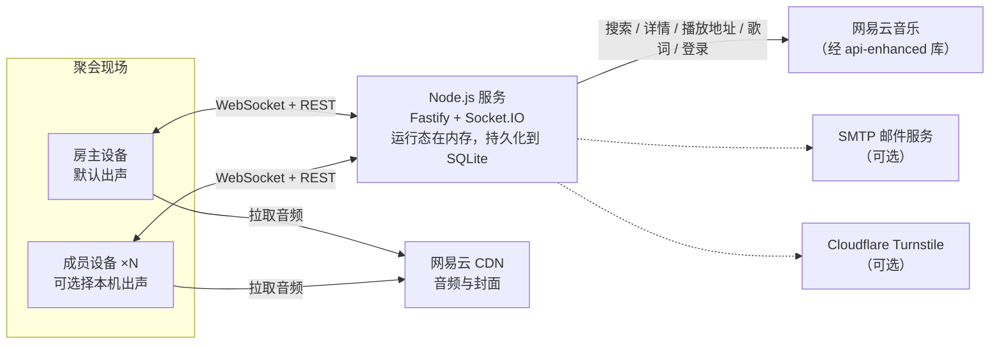
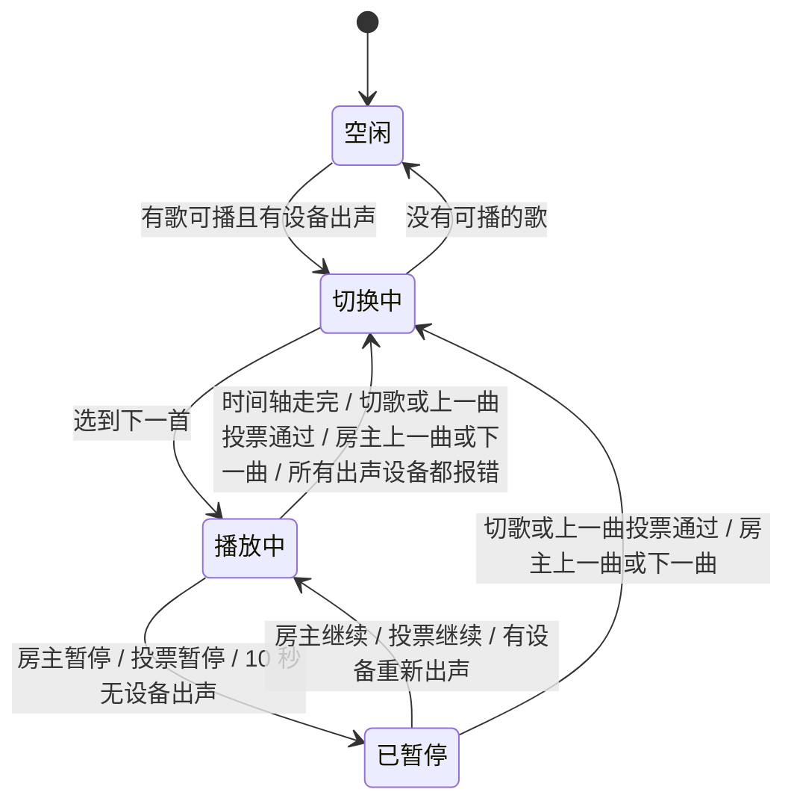
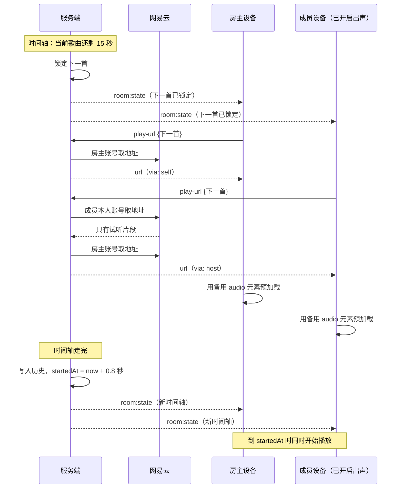

# 聚会音乐播放器 · 架构设计（综合版）

| 项目 | 内容 |
|---|---|
| 来源 | `文档/架构设计/人类/架构.md`（人类版）；`文档/架构设计/agent/架构.md`（Agent 版） |
| 合并方式 | 两版一致的直接采用；有差异的由小组逐条决定（见 0.1）；合并时新增的设计也已由小组逐条确认（见 10.2） |
| 编写者 | AI Agent（Claude 模型），按小组的决定起草 |

## 0. 合并决定

### 0.1 小组的决定

| 差异点 | 人类版 | Agent 版 | 综合版 |
|---|---|---|---|
| 身份 | 注册账号 | 免注册访客 | **必须注册账号** |
| 播放设备 | 默认房主侧出声，用户可自选本机播放，进度同步 | 只有主播放端出声 | **人类版**：每台出声设备各自请求播放地址（同步机制见 4.7） |
| UI 组件库 | Google 官方 Material Web | Vant 4 | **mdui 2**（MD3 Web Components） |
| 房主调整顺序 | 可调整列表顺序 | 置顶、设为下一首 | **置顶 + 设为下一首** |
| 网易云 Cookie | 存数据库 | 只放内存 | **存数据库** |
| 歌词、聊天、莫奈取色、深色模式、搜索歌单 | 有 | 没有 | **全部放进首版** |
| 成员暂停 | 按策略执行 | 只有房主能暂停 | **暂停、继续都按投票策略执行**；上一曲也可以投票（见 10.2） |
| 后端框架 | Fastify + WebSocket | Express 5 + Socket.IO | **Fastify + Socket.IO** |
| "半数以上"的含义 | 偶数人数时未定义 | 至少一半 | **至少一半**，阈值 `⌈P/2⌉` |

### 0.2 直接合并的内容

两版互不冲突的部分直接合并，没有单独提问：

- **来自人类版：** 管理员初始化与用户管理；建房权限；房主自设口令；踢人时可选禁止再进；点歌确认框显示剩余配额（不限配额时不弹）；首次登录设置昵称；成员的进度条禁用；新版 Node.js 原生运行 TS；SQLite；播放地址先用本人账号、再用房主账号的降级顺序；后端校验权限。
- **来自 Agent 版：** 排序算法与问卷权重；防恶意点踩；"在场成员"的定义；下一首锁定；兜底歌单；网易云适配层与可播放性检查；得分透明；全量快照同步；输入校验与限流；测试、里程碑和风险清单。

## 1. 需求

### 1.1 角色

| 角色 | 说明 |
|---|---|
| 管理员 | 系统级角色，首次启动时自动创建。管理用户、授予建房权限、开关邮箱验证和 Turnstile；进入任何房间都拥有房主权限 |
| 房主 | 房间的创建者，拥有该房间的全部权限 |
| 成员 | 已登录、凭房间号和口令加入房间的用户 |

### 1.2 功能需求

| 编号 | 需求 |
|---|---|
| F1 | 注册（可选邮箱验证和 Turnstile）、登录、找回密码（开启邮箱验证时）、修改昵称、密码和邮箱；用户名注册后不能改 |
| F2 | 管理员管理用户（增删改查），授予建房权限，开关邮箱验证和 Turnstile |
| F3 | 有权限的用户可以建房：房间号是随机且未被占用的 6 位数字，口令由房主设置，不填就随机生成 |
| F4 | 凭房间号和口令加入；房主可以踢人，并可选择禁止对方再次进入 |
| F5 | 搜索歌曲和歌单；从搜索结果、歌单或自己的网易云收藏点歌；确认框显示剩余配额；同一首歌被多人点时合并计数 |
| F6 | 对队列中的歌点赞或点踩；队列按投票、点歌人次、提交顺序、热门度、时长五个因素加权动态排序，并展示得分构成 |
| F7 | 切歌、上一曲、暂停、继续都按房间的投票策略执行（任何人 / 一半以上 / 所有人）；房主不受策略限制，直接执行 |
| F8 | 房主可以上一曲、下一曲、暂停、调进度、删歌、置顶、设为下一首、改设置、踢人、重置口令、关闭房间 |
| F9 | 默认只在房主侧出声；房主可改这个默认值，每个用户也可以自己决定本机是否出声；所有出声设备进度同步 |
| F10 | 播放页显示歌名、歌手、专辑封面、进度条和控制按钮，以及逐字歌词和翻译 |
| F11 | 用户可以绑定网易云账号，查看自己的歌单和收藏。取播放地址时先用本人账号，失败或只有试听片段时改用房主账号，再失败就不再尝试 |
| F12 | 房间内文字聊天，包括加入、离开、换歌、暂停等系统消息 |
| F13 | 界面采用 MD3 风格，主题色跟随专辑封面取色（莫奈取色），支持深色模式 |
| F14 | 所有权限都在后端校验，前端不可信 |

### 1.3 非功能需求

- **规模：** 单房间不超过 30 人、队列不超过 200 首；一个服务实例同时承载约 20 个房间。
- **实时性：** 一个人的操作 0.5 秒内出现在所有人的屏幕上；多台设备同时出声时，进度误差目标在 50 毫秒以内（不含蓝牙等输出设备自身的延迟）。
- **恢复：** 手机锁屏、切后台、断网后自动恢复；服务重启后账号、房间、队列、聊天都在。
- **可调：** 排序权重和各项阈值都是配置项，试用后不改代码就能调整。
- **安全：** 密码、登录态、口令不泄露；网易云 Cookie 明文存储的风险与对策见第 7 章。

### 1.4 问卷结论

问卷共 5 份有效答卷，样本小，下表的数值只作为初始默认值，小组试用后再校准。

| 问卷结果 | 设计决策 |
|---|---|
| 第 1 题：常用"随机歌单"（60%）和"每人选一首"（60%） | 核心机制是"每人点歌 + 投票排序"；另提供可选的兜底歌单，队列空了就从里面随机播放 |
| 第 2 题：最担心"有人为了自己的歌先放而恶意点踩"（60%） | 同一个人点踩越多，每一票越轻（见 4.5.3）；对外展示得分构成 |
| 第 3 题综合得分：投票 4、点歌人次 2.6、提交顺序 2.6、热门度 2.4、时长 1 | 归一化后作为默认权重：约 0.32 / 0.21 / 0.21 / 0.19 / 0.08 |
| 第 4 题：80% 选"不限制" | 默认不限配额，房主可设上限 |
| 第 5 题：60% 选"一半以上的人想切才切" | 默认投票模式为"一半以上"，按至少一半计算；同一策略也用于上一曲、暂停和继续 |
| 第 1、2、5 题各有 1 人选了"其他" | 导出报告里没有填写内容，需要到问卷星后台查看 |

## 2. 总体架构

### 2.1 部署



两种部署方式并列支持，按聚会场景选择：

| | 云服务器 | 局域网（房主电脑） |
|---|---|---|
| 访问方式 | 域名 + HTTPS（Caddy 反向代理并自动签发证书） | `http://<电脑局域网 IP>:端口`，成员要连同一个 Wi-Fi |
| 成本 | 服务器和域名费用 | 无 |
| 用手机流量加入 | 可以 | 不行 |
| 账号与邮件 | 可用 | 可用；服务器要能访问外网（网易云、SMTP） |
| Turnstile | 可用 | 按域名白名单工作，官方文档只确认 `localhost` 可加入，局域网 IP 能否加入未确认；建议保持关闭 |
| 登录 Cookie | 带 `Secure` 标志 | HTTP 下不能带 `Secure`；密码和登录 Cookie 在局域网内明文传输，只在可信的网络里使用 |
| 屏幕常亮等安全上下文接口 | 可用 | 只有在房主电脑上用 `localhost` 打开的页面可用 |
| 注意 | 服务器要在国内，否则很多歌会因版权地区限制拿不到播放地址 | 电脑关机或休眠，服务就停了 |

公网部署且开放注册时，建议打开邮箱验证和 Turnstile；局域网部署可以都关闭。

前后端是两个独立的包，只通过 REST 和 Socket.IO 通信。生产环境由后端托管前端构建产物，同源部署，不开放 CORS。

### 2.2 技术选型

| 层 | 选择 | 说明 |
|---|---|---|
| 运行时 | Node.js 26 LTS | 2026 年 10 月 28 日进入 Active LTS；默认支持直接运行 `.ts` 文件 |
| 语言 | TypeScript，由 Node 原生运行 | Node 只是去掉类型标注，不做类型检查：类型检查交给 `tsc --noEmit`；`enum`、带运行时代码的 `namespace`、构造函数参数属性不能用，tsconfig 打开 `erasableSyntaxOnly` |
| Web 框架 | Fastify 5 | 插件：`@fastify/cookie`、`@fastify/jwt`、`@fastify/rate-limit`、`@fastify/static`、`@fastify/helmet` |
| 实时通信 | Socket.IO 4 | 挂在 Fastify 底层的 HTTP server（`fastify.server`）上；自带 ack 确认、房间广播和断线重连 |
| 数据库 | SQLite，用 Node 内置的 `node:sqlite` | 零依赖、同步 API，不用编译原生模块；目前稳定性等级是 1.2（候选版），见第 10 章风险 |
| 校验 | zod | 前后端共用 |
| 密码 | bcryptjs，cost 12 | 纯 JS 实现，不用编译；bcrypt 只取前 72 字节，所以密码上限 64 字符 |
| 人机验证与邮件 | Cloudflare Turnstile；nodemailer + SMTP | 两个独立开关，默认都关闭；邮箱验证要先配置好 SMTP 才能打开 |
| 音乐接口 | `@neteasecloudmusicapienhanced/api` | 在进程内直接调用；锁定版本 |
| 前端 | Vue 3 + Vite + Pinia + Vue Router | 两版一致 |
| UI | mdui 2 | MD3 Web Components，自带动态配色和深色模式 |
| 日志 | pino | 对 Cookie、令牌、密码字段脱敏 |
| 测试 | Vitest；Playwright | Playwright 用于多浏览器同步测试 |
| 工程 | npm workspaces 单仓 | |

### 2.3 关键架构决策

1. **服务端说了算。** 客户端只发送意图（我要点这首、我想切歌），校验、修改、排序和投票判定全在服务端完成，然后广播结果。
2. **服务端时间轴决定播放进度。** 服务端记录"当前歌曲在服务器时间几点开始播放"，每台出声设备都按这条时间轴对齐。哪台设备掉线都不影响播放进度，换歌也由服务端的计时器触发。
3. **每台出声设备各自取播放地址。** 设备向服务端请求地址，服务端先用这台设备登录用户的网易云账号取，失败再用房主的账号取。
4. **内存为主，同步写入 SQLite。** 房间运行态放在内存里，每次修改同步写入 SQLite；重启时从 SQLite 恢复。
5. **全量快照同步。** 每次状态变化后，服务端给每个连接推送一份完整的房间快照（按身份裁剪），带递增版本号。单个房间的数据只有几十 KB。
6. **规则写成纯函数。** 排序、投票判定、配额、时间轴计算都是"输入状态和当前时间，输出结果"的纯函数，方便测试和调参。
7. **隔离第三方接口。** 网易云调用全部收在 `music/` 模块里，对外只暴露项目自己的类型。
8. **单进程。** 目标规模下够用；以后要多实例，再引入 Redis 和 Socket.IO 的 Redis 适配器。

## 3. 账号与权限

### 3.1 管理员初始化

首次启动时如果用户表为空，就创建管理员：用户名 `admin`，密码是随机 16 位字符串（`crypto.randomBytes` 生成），只在启动日志里打印一次。管理员首次登录必须改密码，并且可以改一次用户名。

### 3.2 注册、邮箱验证与 Turnstile

邮箱验证和 Turnstile 是两个独立开关，由管理员在系统设置里控制，默认都关闭。邮箱验证要先在环境变量里配置好 SMTP 才能打开。

- **开启邮箱验证时：** 注册要填用户名、密码、邮箱和 6 位验证码。验证码 10 分钟有效，最多试 5 次；同一邮箱 60 秒内只能发一次，同一 IP 每小时最多发 10 次。
- **关闭邮箱验证时：** 注册只填用户名和密码，邮箱可选。
- **打开 Turnstile 时：** 如果开启了邮箱验证，就在发送验证码前验证，找回密码的重置码（见 3.3）也一样；如果关闭了邮箱验证，就在提交注册前验证。服务端调用 Cloudflare 的 `siteverify` 接口核验。
- **注册限流：** 不管两个开关怎么设，同一 IP 每小时最多注册 5 个账号。
- **用户名：** 3 到 20 位字母、数字或下划线，注册后不能改（管理员首次登录那一次除外）。
- **首次登录：** 弹出模态框，要求设置昵称（1 到 16 字）。昵称、密码、邮箱以后都能改；开启邮箱验证时，改邮箱也要重新验证。

### 3.3 登录态

- 密码用 bcryptjs（cost 12）哈希后存储。
- 登录成功后签发 JWT，内容是 `{ uid, tv }`，其中 `tv` 是用户表里的 `token_version`。JWT 放在 Cookie 里，设置 `HttpOnly` 和 `SameSite=Lax`，HTTPS 部署时再加 `Secure`（由配置项 `COOKIE_SECURE` 决定），7 天过期。
- 每个请求都校验 JWT，并比对 `tv` 与数据库里的值是否一致。改密码、被管理员重置或删除账号时，`token_version` 加 1，旧的登录态全部失效。
- 防 CSRF：Cookie 设 `SameSite=Lax`；所有修改类请求和 Socket.IO 握手都检查 `Origin` 是否为本站。
- 登录失败限流：同一 IP 每分钟 10 次；同一账号 15 分钟内失败 10 次，锁定 15 分钟。
- **找回密码：** 开启邮箱验证时可以自助找回。用户输入用户名或邮箱，服务端向账号已验证的邮箱发送 6 位重置码（打开 Turnstile 时要先通过验证），10 分钟有效，最多试 5 次，发送频率限制与注册验证码相同。不管账号是否存在，都返回同样的提示，不暴露哪些账号存在。重置成功后 `token_version` 加 1，旧的登录态全部失效。关闭邮箱验证时，或者账号没有已验证的邮箱时，由管理员在用户管理里重置。

### 3.4 权限

| 操作 | 管理员 | 房主（本房间） | 成员（本房间） |
|---|---|---|---|
| 管理用户、系统设置 | ✓ | | |
| 点歌、撤回、赞踩、聊天 | ✓ | ✓ | ✓ |
| 发起切歌 / 上一曲 / 暂停 / 继续投票 | | | ✓ |
| 直接切歌、暂停、继续、上一曲、调进度 | ✓ | ✓ | |
| 删歌、置顶、设为下一首 | ✓ | ✓ | |
| 改房间设置、看口令、重置口令、关闭房间 | ✓ | ✓ | |
| 踢人、禁止再进、删聊天消息 | ✓ | ✓ | |

- **建房：** 管理员和被授予建房权限的用户可以建房。每人同时最多有 1 个开放的房间。
- **管理员：** 进房间和普通用户一样要输口令，进去后自动拥有房主权限。
- **配额：** 房主和管理员不受点歌配额限制。
- **踢人：** 不能踢房主和管理员。

## 4. 后端设计

### 4.1 目录结构

```text
party-music-player/
├─ package.json                  # npm workspaces 根配置
├─ packages/
│  ├─ shared/src/
│  │  ├─ types.ts                # 前后端共用的类型
│  │  ├─ events.ts               # Socket.IO 事件名与载荷
│  │  ├─ schemas.ts              # zod 校验
│  │  ├─ errors.ts               # 错误码（用 as const 对象，不用 enum）
│  │  └─ lyrics.ts               # 歌词解析（纯函数，前端使用）
│  ├─ server/src/
│  │  ├─ index.ts                # 启动
│  │  ├─ config.ts               # 环境变量与默认参数
│  │  ├─ db/                     # node:sqlite 连接、建表迁移、按表封装的查询
│  │  ├─ auth/                   # 注册、登录、JWT、Turnstile、邮件
│  │  ├─ http/                   # Fastify 路由与插件
│  │  ├─ realtime/               # Socket.IO 网关、事件处理、广播调度
│  │  ├─ domain/                 # 纯函数：ranking、votes、timeline、presence、room
│  │  ├─ services/               # 编排：roomService、playbackService、chatService
│  │  ├─ music/                  # 网易云接入：neteaseClient、可播放性检查、缓存
│  │  └─ infra/                  # logger、限流、令牌工具
│  └─ web/src/                   # 见第 6 章
└─ data/app.db                   # SQLite 数据库，不提交到 git
```

依赖方向只能是 `http`/`realtime` → `services` → `domain`/`music`/`db`；`domain` 不依赖任何其他层。

### 4.2 数据库表

| 表 | 主要字段 |
|---|---|
| `users` | `id`、`username`（唯一）、`password_hash`、`email`、`email_verified`、`nickname`、`role`（admin / user）、`can_create_room`、`must_change_password`、`can_rename_once`、`token_version`、`created_at` |
| `netease_accounts` | `user_id`（主键）、`netease_uid`、`netease_nickname`、`vip_type`、`cookie`（**明文**，小组决定）、`updated_at` |
| `settings` | `key`、`value`，例如 `email_verification_enabled`、`turnstile_enabled` |
| `rooms` | `id`、`code`、`owner_id`、`passcode`、`status`、`settings_json`、`timeline_json`、`created_at`、`last_active_at` |
| `room_members` | `room_id`、`user_id`、`joined_at`、`last_seen_at`、`left` |
| `room_bans` | `room_id`、`user_id`、`created_at` |
| `queue_items` | `id`、`room_id`、`track_json`、`first_added_at`、`pinned_at`、`state`（queued / playing / played）、`ended_reason`、`ended_at` |
| `queue_adds` | `item_id`、`user_id`、`added_at` |
| `votes` | `item_id`、`user_id`、`value`（1 或 −1） |
| `chat_messages` | `id`、`room_id`、`kind`（user / system）、`user_id`（系统消息为空）、`content`、`system_type`、`payload_json`、`created_at`、`deleted` |

所有 SQL 都用参数化查询。`rooms.code` 只在开放的房间之间唯一（部分唯一索引 `WHERE status = 'open'`），房间关闭后号码可以重新分配。邮箱验证码、切歌 / 暂停 / 继续的投票、各设备的出声状态、各类缓存只放内存。前两者会在服务重启后丢失，影响很小。

### 4.3 运行时模型

数据库是持久化层，服务运行时以内存中的房间对象为准：

```ts
type VoteMode = 'anyone' | 'half' | 'all'

interface RoomRuntime {
  id: string
  code: string
  ownerId: string
  passcode: string
  settings: RoomSettings
  members: Map<string, MemberRuntime>   // userId → 成员
  queue: Map<string, QueueItem>         // 待播歌曲
  upNextId: string | null               // 已锁定的下一首（见 4.5.5）
  timeline: Timeline                    // 播放时间轴（见 4.7）
  playVotes: {                          // 当前歌曲的投票，清空规则见 4.6.2
    skip: Set<string>
    prev: Set<string>
    pause: Set<string>
    resume: Set<string>
  }
  listeners: Map<string, { userId: string; listening: boolean; errorItemId: string | null }>  // socketId → 出声状态
  history: PlayedItem[]
  version: number
}

interface RoomSettings {
  quotaPerMember: number | null         // null = 不限（默认）
  voteMode: VoteMode                    // 默认 'half'；切歌、暂停、继续共用
  weights: { vote: number; adds: number; order: number; popularity: number; duration: number }
  memberAudioDefault: boolean           // 成员设备是否默认出声，默认 false
  allowTrialTracks: boolean             // 默认 false
  audioLevel: 'standard' | 'exhigh' | 'lossless'
  fallbackPlaylistId: string | null
}

interface MemberRuntime {
  userId: string
  nickname: string
  isHost: boolean                       // 房主或管理员
  online: boolean
  lastSeenAt: number
  left: boolean
}

interface Track {
  source: 'netease'
  sourceId: string
  title: string
  artists: string[]
  album: string
  coverUrl: string
  durationMs: number
  popularity: number | null             // 0–100，网易云歌曲详情的 pop 字段
  playability: 'full' | 'trial' | 'unavailable'  // 用房主账号实测的结果
}

interface QueueItem {
  id: string                            // 每次入队生成新 id；查重用 source + sourceId
  track: Track
  addedBy: string[]                     // 点过这首歌的用户 id，按先后顺序
  firstAddedAt: number
  votes: Map<string, 1 | -1>            // userId → 赞或踩
  pinnedAt: number | null
}

interface PlayedItem {
  track: Track
  addedBy: string[]
  endedAt: number
  reason: 'finished' | 'skipped' | 'removed' | 'error'
}
```

### 4.4 房间

**建房：** 有权限的用户填口令（4 到 16 位，不填就随机生成 4 位数字）。服务端生成随机且未被占用的 6 位房间号，写入 `rooms`，建房者成为房主。

**加入：**

1. 用户登录后输入房间号和口令。
2. 服务端检查房间是否开放、用户是否在 `room_bans` 里，再用 `timingSafeEqual` 比对口令。
3. 通过后写入 `room_members`。之后同一用户再进这个房间不用再输口令，口令重置也不影响已经加入的人。
4. 防暴力猜口令：同一用户每分钟最多尝试 10 次；同一房间 10 分钟内失败 30 次，暂停新加入 2 分钟并通知房主。

**踢人：** 删除对方的 `room_members` 记录，撤销其投票和点歌（只有这个人点过的歌从队列中删除），断开对方在本房间的连接。勾选"禁止再次进入"时，同时写入 `room_bans`。

**在场成员：** 没有主动离开，并且当前在线或最近 10 分钟内有过连接。在场人数记为 P，最小取 1。投票归一化和投票阈值都用 P。

**点歌规则：**

- 配额只统计"自己点的、还在队列里待播"的歌；房主和管理员不受限。
- 设了配额时，确认框显示"还能点 N 首，确定添加？"；不限配额时不弹确认框。
- 点一首已经在队列里的歌，就把自己加进这首歌的 `addedBy`，占一个名额。
- 正在播放的歌不能再点；已经播过的可以再点。
- 撤回：把自己从 `addedBy` 中移除，没有其他人点过就从队列删除。
- 点歌时用房主的网易云账号检查可播放性（见 4.8.3）。

### 4.5 排序算法

#### 4.5.1 总分

```text
总分 = 100 × (w投票·s投票 + w人次·s人次 + w顺序·s顺序 + w热门·s热门 + w时长·s时长)
```

默认权重是问卷第 3 题综合得分的原始比例（4 / 2.6 / 2.6 / 2.4 / 1），运行时按总和归一化。房主在设置里改的也是比例。

#### 4.5.2 五个因素

| 因素 | 分数 s（0 到 1） | 含义 |
|---|---|---|
| 投票 | `clamp(0.5 + V / P, 0, 1)`，V 是加权净票数 | 没人投票时 0.5；净赞达到在场人数一半时满分 |
| 点歌人次 | `min(1, 2n / P)`，n 是点过这首歌的人数 | 在场的人有一半点了这首歌时满分 |
| 提交顺序 | `min(1, 已等待分钟数 / 60)` | 等得越久分越高，60 分钟封顶，也防止被踩的歌永远播不到 |
| 热门度 | `pop / 100`，没有数据取 0.5 | |
| 时长 | 2 分钟及以下得 1，7 分钟及以上得 0，中间线性递减 | 短歌优先 |

#### 4.5.3 防恶意点踩

1. **踩得越多，每票越轻。** 某用户当前在队列里一共踩了 k 首歌，这个用户的每个踩按 `1/√k` 计入。只踩 1 首，分量等于一个赞；踩 4 首，每票 0.5。赞不做摊薄。`V = 在场成员的赞数 − Σ 在场成员每个踩的分量`。
2. **不能给自己点的歌投票。** 先投票再点这首歌，原来的投票作废。
3. **踩只能推迟，不能埋掉。** 10 人房间里，一首被 3 个人各踩一次的歌，其他条件相同时，大约多等 28 分钟就能和一首刚点的中性歌排在一起。
4. **房主能看到谁踩了哪首歌**，成员只能看到赞和踩的数量。

#### 4.5.4 各因素的实际影响

| 变化 | P = 5 | P = 10 | P = 20 |
|---|---|---|---|
| 多 1 个赞（或少 1 个踩） | +6.3 | +3.2 | +1.6 |
| 多 1 个人点这首歌 | +8.3 | +4.1 | +2.1 |
| 多等 10 分钟 | +3.4 | +3.4 | +3.4 |
| 热度高 10 点 | +1.9 | +1.9 | +1.9 |
| 时长短 1 分钟 | +1.6 | +1.6 | +1.6 |

热度 95 和热度 40 的歌相差 10.5 分，在 10 人房间里约等于 3 个赞。如果试用时发现热门歌总排在前面，先调低热门度权重。

#### 4.5.5 最终顺序与下一首锁定

1. 置顶的歌排最前，按置顶时间先后。
2. 其余按总分从高到低；同分时先点的排前面。

**下一首锁定：** 时间轴上当前歌曲还剩 15 秒时，服务端的计时器把此刻排第一的歌锁定为下一首，这首歌不再参与重排，并通知所有出声设备预加载。房主可以手动更换或删除下一首，这会解除锁定并重新选。

**何时重算：** 点歌、撤回、投票、成员进出、改设置后立即重算；另外每 60 秒重算一次。有变化才广播。

### 4.6 切歌、上一曲、暂停与继续

#### 4.6.1 投票阈值

切歌、上一曲、暂停、继续四种投票共用房间的 `voteMode`：

| 模式 | 通过条件 |
|---|---|
| 任何人（`anyone`） | 1 票 |
| 一半以上（`half`，默认） | 投票的在场人数 ≥ `⌈P/2⌉`，即至少一半：5 人需 3 票，6 人需 3 票 |
| 所有人（`all`） | 投票的在场人数 = P |

房主和管理员按下按钮就直接执行，不经过投票。

#### 4.6.2 各投票什么时候有效

| 投票 | 可以发起的状态 | 通过后 |
|---|---|---|
| 切歌 | 播放中；已暂停 | 换下一首并开始播放 |
| 上一曲 | 播放中；已暂停；并且历史里有可重播的歌 | 重播上一首并开始播放（见 4.6.3） |
| 暂停 | 播放中 | 时间轴暂停，暂停原因记为"投票" |
| 继续 | 因房主或投票而暂停 | 时间轴继续 |

- **房主暂停的，成员也可以投票继续。** 因无人出声而暂停的不需要投票，有设备重新出声就自动继续。
- **投票要带上当前歌曲的 id。** id 已经过期（歌刚好换了）的投票直接忽略。
- **什么时候清空：** 换歌时四种投票全部清空；暂停或继续时，清空暂停票和继续票，切歌票和上一曲票保留。
- **可以撤回自己的票。** 在场人数变化时重新判断阈值。
- **防来回拉扯：** "任何人"模式下每人 30 秒内只能触发一次；任何一次暂停或继续生效后（不论是房主操作还是投票通过），10 秒内不接受反向投票。这样房主刚暂停时，不会马上被投票推翻。
- **界面：** 成员的"上一曲""下一曲""暂停 / 继续"按钮上显示实时进度，例如"切歌 2/3"。成员的进度条是禁用状态。

#### 4.6.3 上一曲

- 重播历史里最近一首不是因出错而结束的歌。
- 正在播的歌不写入历史，放回队列并锁定为下一首，进度从头开始。
- 房主直接执行和投票通过的效果相同。历史里没有可重播的歌时，按钮禁用。

#### 4.6.4 房主专属操作

调进度、删歌、置顶、设为下一首，都直接执行。

### 4.7 播放时间轴与多设备同步

#### 4.7.1 时间轴

```ts
interface Timeline {
  itemId: string | null
  durationMs: number
  state: 'idle' | 'playing' | 'paused'
  startedAt: number                 // 服务器时间：当前歌曲的第 0 毫秒对应的时刻
  pausedAtMs: number                // 暂停时的进度
  pausedBy: 'host' | 'vote' | 'noListener' | null
}
```

- 当前进度 = 播放中时 `now − startedAt`，暂停时 `pausedAtMs`。
- 暂停：`pausedAtMs = now − startedAt`。继续：`startedAt = now − pausedAtMs`。房主调进度到 x：播放中时 `startedAt = now − x`，暂停时 `pausedAtMs = x`。
- 计时器：在 `startedAt + durationMs` 换下一首，在结束前 15 秒锁定下一首。时间轴每次变化都重新设置这两个计时器。
- 时长以歌曲详情里的时长为准。某台设备的音频提前结束就静音等待；还没播完的，到点也统一切换。



继续播放的方式与暂停原因有关：房主暂停或投票暂停的，可以由房主继续，也可以投票继续；因无人出声而暂停的，有设备重新出声就自动继续。

**"切换中"的步骤：**

1. 把刚结束的歌写入历史，记录结束原因（上一曲打断的歌除外，见 4.6.3）。
2. 取下一首：上一曲时取历史里的那首；否则优先取已锁定的下一首，再取队列第一名；队列为空时，如果设置了兜底歌单，就从中随机取一首（避开最近 20 首播过的歌）。
3. 设置时间轴，`startedAt = now + 缓冲`：下一首已经预加载过时缓冲 0.8 秒，否则 2 秒，给设备留出加载时间。然后广播快照。
4. 各出声设备自己请求播放地址（预加载过就直接用），到 `startedAt` 时开始播放。
5. 连续 3 首都以 `error` 结束时，停在空闲状态并通知房主。

#### 4.7.2 每台设备取播放地址

出声设备调用 `POST /api/rooms/:code/play-url`，参数是 `{ itemId }`。服务端按下面的顺序尝试，前一步失败或只拿到试听片段，才进入下一步：

1. 用这台设备登录用户本人的网易云账号取地址（没有绑定就跳过）。
2. 用房主的网易云账号取地址（请求者就是房主时，与第 1 步相同，跳过）。
3. 房间允许试听歌曲时，接受试听地址。
4. 返回 `TRACK_UNAVAILABLE`。这台设备静音，但仍然跟着时间轴，下一首照常尝试。

返回 `{ url, expiresAt, via: 'self' | 'host' | 'trial' }`。服务端按"请求者 + 歌曲 + 音质"缓存结果，有效期短于地址本身的过期时间，只用来合并同一个人的重复请求。不同用户之间不共享地址，保持"每台设备各自请求"的设计。每人每分钟最多请求 30 次。

#### 4.7.3 时钟同步

设备的系统时间可能与服务器差几百毫秒，所以先测时差：

1. 设备发 `time:ping { t0 }`，服务端回 `{ t0, ts }`，设备在 t1 时刻收到。
2. 往返时间 `rtt = t1 − t0`，时差 `offset = ts + rtt/2 − t1`。
3. 连上后连续测 5 次，取 rtt 最小的那次的 offset；之后每 30 秒再测一次。
4. 服务器时间 ≈ 本机时间 + offset。

#### 4.7.4 漂移修正

出声设备每秒计算一次：应在进度 `expected = 服务器时间 − startedAt`，实际进度是 `audio.currentTime`，两者之差为 drift。

| drift | 处理 |
|---|---|
| 大于 500 毫秒 | 直接跳到 `expected` |
| 40 到 500 毫秒 | 把 `playbackRate` 调到 1.02 或 0.98 追赶，追上后恢复 1.0（`preservesPitch` 保持音调不变） |
| 小于 40 毫秒 | 不处理 |
| `expected` 小于 0（还没到开始时刻） | 停在开头等待 |

蓝牙音箱、电视等输出设备本身的延迟测不到，也无法修正。多台设备在同一个空间出声会有回声，建议同一个空间只开一台设备出声，其他人戴耳机。

#### 4.7.5 出声规则

- **自动播放限制：** 浏览器要求用户点击后才能出声。打开"本机出声"开关的那一下点击就用来解锁音频；刷新页面后要重新点一次，页面会提示。
- **默认值：** 房主和管理员的设备默认出声，但如果本人已有另一台设备在出声，新设备默认不出声，避免同一个人的两台设备在一起产生回声。成员设备的默认值由房间设置 `memberAudioDefault` 决定（默认关）。每台设备自己选择的开关状态保存在 `localStorage` 里，优先于默认值。
- **上报：** 设备通过 `audio:listening { on }` 上报本机是否出声，连接断开就算不出声。
- **无人出声：** 连续 10 秒没有任何设备出声，时间轴自动暂停，原因记为 `noListener`；有设备重新出声就自动继续。这样不会出现"没人在听，歌却一首首播完"的情况。
- **播放出错：** 设备先用当前进度重新取一次地址再试。仍然失败，就上报 `audio:error { itemId }`，这台设备静音。所有正在出声的设备都对同一首歌报错时，服务端以 `error` 为原因切到下一首。
- **音量：** 各设备自己调，不经过服务端。
- **防息屏：** 出声设备申请 Screen Wake Lock。这个接口要求安全上下文：HTTPS 部署时都能用；局域网 HTTP 部署时，只有在房主电脑上用 `localhost` 打开的页面能用，其他设备上前端检测到不支持就跳过。

#### 4.7.6 换歌时序



### 4.8 网易云音乐接入

#### 4.8.1 依赖与适配接口

使用 `@neteasecloudmusicapienhanced/api`，在 `package.json` 里锁定版本。这是非官方接口，登录类接口历史上多次失效，所以 M0 先用脚本验证搜索、歌曲详情、取播放地址、扫码登录、歌词和封面这几项在当前版本下都能用。

`music/neteaseClient.ts` 只暴露下面这些方法，返回值都是项目自己的类型：

```ts
interface MusicProvider {
  searchTracks(keyword: string, page: number): Promise<Track[]>              // cloudsearch, type=1
  searchPlaylists(keyword: string, page: number): Promise<PlaylistSummary[]>  // cloudsearch, type=1000
  getTracks(ids: string[]): Promise<Track[]>                                 // song_detail，含 pop
  getPlayUrl(id: string, level: AudioLevel, cookie?: string)
    : Promise<{ url: string | null; trialOnly: boolean; expiresAt: number }> // song_url_v1
  getLyrics(id: string): Promise<RawLyrics>                                  // lyric_new
  getUserPlaylists(cookie: string): Promise<PlaylistSummary[]>               // user_playlist；第一个是"我喜欢的音乐"
  getPlaylistTracks(id: string, page: number, cookie?: string): Promise<Track[]>  // playlist_track_all
  createLoginQr(): Promise<{ key: string; qrImage: string }>                 // login_qr_key + login_qr_create
  checkLoginQr(key: string): Promise<QrStatus>                               // login_qr_check：800 过期 / 801 等待扫码 / 802 待确认 / 803 成功
  getAccount(cookie: string): Promise<NeteaseAccount>                        // 含是否会员
}
```

- **缓存：** 搜索和歌单 5 分钟，歌曲详情 1 小时，歌词 24 小时，用 LRU 缓存。
- **限流：** 对网易云的并发请求最多 5 个；每人每分钟最多搜索 20 次。

#### 4.8.2 绑定网易云账号

- 在个人设置里扫码绑定：网页显示二维码，用户用手机网易云 App 扫码确认，前端每 2 秒轮询一次状态。成功后 Cookie 写入 `netease_accounts`，因为存在数据库里，换设备也不用重新绑。
- 只有一台手机的用户，可以在房间里点"在房主屏幕上显示二维码"，用自己手机的网易云 App 扫房主屏幕上的码。也可以提前在电脑上绑定好。
- 不想登录的，可以粘贴歌单分享链接，服务端不带 Cookie 读取公开歌单。
- 不提供手机号加短信验证码登录：这个接口最容易触发风控。
- 房主绑定的账号就是房间的"主账号"，用于可播放性检查和取播放地址时的降级。

#### 4.8.3 可播放性检查

点歌时，服务端用房主的 Cookie 实际取一次播放地址：

- 拿不到地址，记为 `unavailable`，拒绝点歌并提示原因。
- 只有试听片段，记为 `trial`，默认拒绝；房间设置 `allowTrialTracks` 打开时可以点。
- 其他情况记为 `full`。

结果缓存 10 分钟。房主绑定、解绑或换绑账号时，整个队列重新检查一遍。

#### 4.8.4 Cookie 存储

小组决定把网易云 Cookie 明文存在 `netease_accounts.cookie`。在此前提下采取以下措施：

- Cookie 不通过任何接口返回给前端，不进日志（pino 脱敏），不进广播快照。
- 数据库文件放在网站目录之外，文件权限设为只有服务进程能读写（如 `chmod 600`）。
- 数据库备份和数据库本身一样，按敏感数据保管。
- 用户解绑或账号被删除时，立即删除这一行。
- 绑定页面告诉用户："你的网易云登录状态会保存在本站服务器上，可随时解绑。"

#### 4.8.5 封面取色代理

莫奈取色需要在浏览器里读取封面图片的像素。如果网易云图片 CDN 不返回 CORS 头，canvas 会被污染，读不到像素。M0 先验证这一点；不行就提供 `GET /api/music/cover?url=` 代理：

- 只代理网易云图片域名白名单里的 HTTPS 地址，不跟随重定向。
- 只取小尺寸缩略图，限制响应大小。
- 结果缓存。

这样限制是为了防止有人借这个接口访问内网地址（SSRF）。

### 4.9 歌词

- **获取：** 服务端调 `lyric_new` 取歌词，缓存 24 小时，原样转给前端。按网易云接口文档，`yrc` 是逐字歌词，`lrc` 是逐行歌词，`tlyric` 是翻译；这些字段名 M0 时要用实际返回再确认一遍。
- **解析：** `shared/lyrics.ts` 里的纯函数，在前端运行，输出 `{ startMs, endMs, text, words?: { startMs, durationMs, text }[], translation? }[]`。逐字歌词每行记录本行的起止时间和每个字的时间；以 `{` 开头的 JSON 元数据行（作词、作曲等信息）跳过。翻译按时间戳对齐到最近的一行（误差 500 毫秒以内）。
- **兜底：** 没有逐字歌词就用逐行歌词，都没有就显示"暂无歌词"。可以参考奶酪音乐的实现。
- **同步：** 歌词按服务端时间轴计算进度，不依赖本机音频，所以不出声的设备也能同步滚动歌词。

### 4.10 聊天

- **发送：** 消息 1 到 200 字，去掉控制字符；每人 10 秒内最多 5 条。服务端写入 `chat_messages`，再通过 `chat:message` 广播。
- **历史：** 进房间时用 `GET /api/rooms/:code/chat?before=` 分页拉取最近 50 条。
- **管理：** 房主和管理员可以删除消息，删除后广播 `chat:deleted`，所有人的界面同步移除。被踢的人不能再发消息。
- **渲染：** 一律按纯文本显示，不解析 HTML 或 Markdown。

**系统消息（首版就做）：**

| 事件 | 示例 |
|---|---|
| 加入、离开房间 | "小明加入了房间" |
| 换歌 | "正在播放：歌名 - 歌手"，切歌时注明"投票切歌"或"房主切歌" |
| 上一曲、暂停、继续 | 注明是投票通过还是房主操作 |
| 被踢出房间 | "小明被移出房间"（不显示是否禁止再进） |
| 房间设置变化 | 投票模式、配额等变化 |
| 房间关闭 | "房间已关闭" |

- **不发系统消息的情况：** 锁屏等短暂断线（只有首次加入和主动离开后再进才算"加入"）、每一张投票、重置口令、因无人出声而自动暂停。
- **防刷屏：** 同一个人的加入和离开消息，60 秒内只记一条。
- **存储：** 和普通消息存在同一张表，`kind = 'system'`，`user_id` 为空，`system_type` 和 `payload_json` 记录事件类型和参数，前端按模板生成文字。系统消息不能删除，不计入发送频率限制。

### 4.11 并发、持久化与房间生命周期

**并发：** Node.js 是单线程的，只要一次修改中间没有 `await`，同一房间的修改就不会交错。每个事件处理器都按三步写：

1. 先异步取外部数据（歌曲详情、可播放性）。
2. 再同步地重新校验，修改内存，并在同一个 SQLite 事务里写库（`node:sqlite` 是同步 API，正好契合这一步）。
3. 最后版本号加 1，安排一次广播。同一房间 150 毫秒内的多次修改合并成一次广播。

**幂等：** 投票是"设置为某个值"而不是"切换"，切歌、上一曲、暂停、继续的投票存在 Set 里，重复点歌会合并。客户端重连后重发请求，结果不变。

**写库时机：** 队列、投票、成员、聊天每次修改都写。时间轴只在暂停、继续、调进度、换歌时写，不按秒写。SQLite 开启 WAL 模式。

**重启恢复：** 启动时从 SQLite 读出所有开放的房间放进内存。原本在播放的，改为因无人出声而暂停，进度停在 `now − startedAt`，有设备重新出声就继续；原本是房主暂停的，保持原状。

**房间关闭：** 出现以下情况之一时关闭：房主点"关闭房间"；所有成员断开超过 2 小时；创建超过 24 小时。关闭时广播 `room:closed`，删除这个房间的队列、投票、成员、禁入名单和聊天记录；`rooms` 里保留一行，状态记为 closed。

## 5. 通信接口

### 5.1 REST

前缀都是 `/api`。登录态放在 Cookie 里；修改类请求都要检查 `Origin`。

| 方法与路径 | 权限 | 用途 |
|---|---|---|
| `POST /auth/email-code` | 任何人；打开 Turnstile 时需先验证 | 发送注册验证码（开启邮箱验证时） |
| `POST /auth/register` | 任何人，限流 | 注册 |
| `POST /auth/login`、`POST /auth/logout` | 任何人 | 登录、退出 |
| `POST /auth/password-reset/request` | 任何人，限流；打开 Turnstile 时需先验证 | 发送重置码（开启邮箱验证时） |
| `POST /auth/password-reset/confirm` | 任何人，限流 | 凭重置码设置新密码 |
| `GET /me`、`PATCH /me` | 已登录 | 读取、修改昵称 |
| `POST /me/password`、`POST /me/email`、`POST /me/username` | 已登录 | 改密码；改邮箱（需验证）；改用户名（仅管理员首次登录） |
| `GET/POST/PATCH/DELETE /admin/users[/:id]` | 管理员 | 用户增删改查，含授予建房权限、重置密码 |
| `GET/PATCH /admin/settings` | 管理员 | 系统设置：开关邮箱验证和 Turnstile |
| `POST /admin/settings/test-email` | 管理员 | 向指定邮箱发一封测试邮件，确认 SMTP 可用 |
| `POST /rooms` | 有建房权限 | 建房 |
| `GET /rooms/:code` | 已登录 | 查询房间是否开放、自己是否已加入 |
| `POST /rooms/:code/join` | 已登录，限流 | 凭口令加入 |
| `GET /rooms/:code/chat?before=` | 房间成员 | 聊天记录分页 |
| `POST /rooms/:code/play-url` | 房间成员 | 取播放地址（见 4.7.2） |
| `GET /music/search?type=track\|playlist&q=&page=` | 已登录，限流 | 搜索歌曲或歌单 |
| `POST /music/playlist/resolve` | 已登录 | 解析歌单分享链接 |
| `GET /music/playlists/:id/tracks?page=` | 已登录 | 歌单曲目（绑定了网易云就带上本人的 Cookie） |
| `GET /music/lyrics/:id` | 已登录 | 歌词 |
| `GET /music/cover?url=` | 已登录 | 封面取色代理（见 4.8.5） |
| `POST /netease/login/qr`、`GET /netease/login/qr/:key` | 已登录 | 生成绑定二维码（可选推送到房主屏幕）、轮询状态 |
| `GET /netease/me`、`GET /netease/me/playlists`、`DELETE /netease/me` | 已登录 | 绑定信息、本人歌单、解绑 |

### 5.2 Socket.IO 事件

握手时浏览器自动带上登录 Cookie，服务端校验 JWT 和 `Origin`。连上后发 `room:enter { code }`，服务端确认这个用户是房间成员且没有被禁入，再把连接加入房间频道。同一用户可以有多条连接（多台设备）。客户端事件都带 ack，返回 `{ ok: true, data }` 或 `{ ok: false, code }`。

**客户端 → 服务端**

| 事件 | 载荷 | 权限 |
|---|---|---|
| `room:enter`、`room:leave` | `{ code }` | 房间成员 |
| `queue:add` | `{ sourceId }` | 成员 |
| `queue:withdraw` | `{ itemId }` | 点过这首歌的成员 |
| `vote:set` | `{ itemId, vote: 1 \| -1 \| 0 }` | 成员，不能投自己点的歌 |
| `play:vote` | `{ kind: 'skip' \| 'prev' \| 'pause' \| 'resume', itemId, on: boolean }` | 成员（房主按钮直接走 `host:playback`） |
| `audio:listening` | `{ on: boolean }` | 任何连接 |
| `audio:error` | `{ itemId }` | 出声设备 |
| `time:ping` | `{ t0 }` | 任何连接 |
| `chat:send` | `{ content }` | 成员 |
| `host:playback` | `{ action: 'pause' \| 'resume' \| 'next' \| 'prev' \| 'seek', positionMs? }` | 房主、管理员 |
| `host:queue` | `{ action: 'remove' \| 'pin' \| 'unpin' \| 'setNext', itemId }` | 房主、管理员 |
| `host:settings` | `Partial<RoomSettings>` | 房主、管理员 |
| `host:kick` | `{ userId, ban: boolean }` | 房主、管理员 |
| `host:chatDelete` | `{ messageId }` | 房主、管理员 |
| `host:resetPasscode`、`host:close` | 无 | 房主、管理员 |

**服务端 → 客户端**

| 事件 | 发给谁 | 内容 |
|---|---|---|
| `room:state` | 每个连接各发一份 | 按身份裁剪的完整快照（见 5.3） |
| `room:notice` | 相关的人 | 提示，例如"切歌成功""你的歌因无法播放被移除" |
| `room:closed` | 全房间 | 房间已关闭 |
| `member:kicked` | 被踢的人 | 断开连接前的通知 |
| `chat:message`、`chat:deleted` | 全房间 | 新消息、删除消息 |
| `netease:loginQr` | 房主的所有设备 | 在房主屏幕上显示某位成员的绑定二维码 |

### 5.3 房间快照

```ts
interface RoomSnapshot {
  version: number
  serverNow: number
  room: { code: string; status: 'open' | 'closed'; settings: RoomSettings }
  me: {
    userId: string
    isHost: boolean
    quotaUsed: number
    quotaLimit: number | null
    neteaseBound: boolean
  }
  timeline: Timeline
  nowPlaying: {
    item: QueueItemView
    votes: Record<'skip' | 'prev' | 'pause' | 'resume', { count: number; needed: number; mine: boolean; open: boolean }>
  } | null                                         // open 表示当前状态下能否发起这种投票
  upNext: QueueItemView | null
  queue: QueueItemView[]                           // 已按 4.5.5 排好序
  members: { id: string; nickname: string; isHost: boolean; present: boolean; listening: boolean }[]
  host?: {                                         // 只有房主和管理员的快照里有
    passcode: string
    votersByItem: Record<string, { up: string[]; down: string[] }>
    neteaseVip: boolean
  }
}

interface QueueItemView {
  id: string
  track: Track
  addedBy: { id: string; nickname: string }[]     // 谁点的歌是公开的
  up: number
  down: number                                     // 只给数量，不暴露投票人
  myVote: 1 | -1 | 0
  mine: boolean
  score: { total: number; vote: number; adds: number; order: number; popularity: number; duration: number }
}
```

服务端为每个连接单独生成快照，因为 `me`、`myVote` 和 `mine` 因人而异，口令和投票人名单只给房主。客户端收到 `version` 不大于本地版本的快照时直接丢弃。

### 5.4 错误码

定义在 `shared/errors.ts`（用 `as const` 对象），前端统一映射成中文提示：

- **账号：** `UNAUTHORIZED`、`BAD_CREDENTIALS`、`ACCOUNT_LOCKED`、`MUST_CHANGE_PASSWORD`、`USERNAME_TAKEN`、`EMAIL_CODE_INVALID`、`TURNSTILE_FAILED`
- **权限：** `FORBIDDEN`、`ROOM_LIMIT_REACHED`
- **房间：** `ROOM_NOT_FOUND`、`ROOM_CLOSED`、`BAD_PASSCODE`、`JOIN_PAUSED`、`BANNED`
- **队列与投票：** `QUOTA_EXCEEDED`、`TRACK_UNAVAILABLE`、`TRACK_TRIAL_ONLY`、`ALREADY_PLAYING`、`CANNOT_VOTE_OWN`、`STALE_ITEM`、`VOTE_NOT_OPEN`、`VOTE_COOLDOWN`、`NO_HISTORY`
- **其他：** `CHAT_RATE_LIMITED`、`RATE_LIMITED`、`NETEASE_ERROR`、`VALIDATION_FAILED`

## 6. 前端设计

### 6.1 页面与路由

| 路由 | 页面 |
|---|---|
| `/login`、`/register`、`/forgot-password` | 登录、注册、找回密码（开启邮箱验证时显示入口） |
| `/setup` | 首次登录：设置昵称；管理员还要改密码，可以改一次用户名 |
| `/` | 首页：建房（有权限时）、输入房间号 |
| `/r/:code` | 输入口令加入；已经加入过就直接进房间 |
| `/r/:code/room` | 房间页 |
| `/settings` | 个人设置：昵称、密码、邮箱、网易云绑定、主题 |
| `/admin` | 管理后台：用户管理；系统设置（邮箱验证、Turnstile、测试发信） |

路由守卫：没登录就跳转到 `/login`；还没设置昵称（或管理员还没改密码）就跳转到 `/setup`。

### 6.2 房间页布局

mdui 2 没有底部弹层（bottom sheet）和搜索栏组件，所以用全屏对话框代替底部弹层，用 `mdui-text-field` 做搜索框。

- **顶部栏（`mdui-top-app-bar`）：** 房间号、在场人数、"本机出声"开关；房主多一个管理菜单，包括房间设置、成员与禁入、显示口令、重置口令、关闭房间。
- **内容区（`mdui-navigation-bar` 切换）：** 搜索（歌曲 / 歌单）、我的歌单、聊天。
- **常驻播放控件：** 位于底部导航栏上方，显示封面、歌名、暂停 / 继续、下一曲和播放列表按钮。成员的按钮上显示投票进度。
- **播放页（点播放控件打开的全屏对话框）：** 专辑封面、歌名、歌手、专辑、进度条（成员禁用）、上一曲、暂停 / 继续、下一曲（成员的这三个按钮显示投票进度），逐字歌词和翻译开关，本机音量。
- **播放列表（全屏对话框）：** 当前顺序、赞 / 踩、得分构成；房主可以删除、置顶、设为下一首。

### 6.3 主题

- **莫奈取色：** 换歌时用 mdui 的 `getColorFromImage` 从封面取主色，再用 `setColorScheme` 生成整套配色。取不到时用默认种子色。封面图片的跨域问题见 4.8.5。
- **深色模式：** 用 mdui 的 `setTheme` 切换浅色、深色、跟随系统，默认跟随系统，选择保存在 `localStorage`。
- **在 Vue 中使用 mdui：** `vite.config` 里 Vue 插件设置 `isCustomElement: (tag) => tag.startsWith('mdui-')`。mdui 组件不支持 `v-model`，要写成 `:value` 加 `@input`。

### 6.4 目录与交互要点

```text
packages/web/src/
├─ api/http.ts            # fetch 封装：带上 Cookie，把错误码翻译成中文
├─ realtime/socket.ts     # 重连、回到前台时重新同步、时钟同步、按版本号丢弃旧快照
├─ stores/                # auth、room、music、prefs（主题、本机出声）
├─ player/AudioEngine.ts  # 两个 audio 元素交替；预加载、漂移修正、出错重试、Wake Lock
├─ lyrics/                # 歌词滚动组件，进度按服务端时间轴计算
├─ views/                 # 与 6.1 的页面一一对应
└─ components/            # 队列卡片、播放控件、播放页、搜索、歌单、聊天、房主菜单
```

- **投票即时反馈：** 点赞后按钮立刻高亮，等快照到达再校正。排序只听服务端的，前端不自己预测。
- **重排动画：** 队列用 `TransitionGroup`，让动态排序看得见。
- **断线：** Socket 断开时顶部显示"正在重连"；页面回到前台就立即重连并拉取最新快照。
- **提示：** 用 `mdui-snackbar` 显示 `room:notice` 和错误。
- **系统消息：** 在聊天里居中、用小号浅色文字显示，与普通消息区分开。

## 7. 安全与隐私

| 方面 | 措施 |
|---|---|
| 密码 | bcryptjs，cost 12；长度 8 到 64 字符；管理员初始密码首次登录必须改 |
| 登录态 | JWT 放在 `HttpOnly`、`SameSite=Lax` 的 Cookie 里，HTTPS 部署时加 `Secure`；靠 `token_version` 作废旧登录态 |
| CSRF | `SameSite=Lax`，加上修改类请求和 Socket 握手都检查 `Origin` |
| 暴力破解 | 登录、口令、验证码、重置码、注册都限流；打开 Turnstile 时，发验证码、发重置码或提交注册前要先通过验证 |
| 权限 | 每个处理器先检查登录、房间成员身份、是否房主或管理员、房间状态；前端隐藏按钮只是体验 |
| 输入校验 | REST 和 Socket 的载荷都用 shared 里的 zod schema 校验；所有 SQL 用参数化查询 |
| XSS | 歌名、昵称、聊天一律按纯文本渲染，禁止 `v-html`；`@fastify/helmet` 设置 CSP，图片和音频只允许本站和网易云 CDN |
| SSRF | 封面代理只允许网易云图片域名白名单（见 4.8.5） |
| 防刷 | 每条连接每秒最多 20 个事件；搜索、聊天、取播放地址分别限流 |
| 网易云 Cookie | **明文存储（小组决定）**；不下发、不进日志，数据库文件只允许服务进程读写，解绑即删（见 4.8.4） |
| 部署 | HTTPS 部署时 Cookie 带 `Secure`；局域网 HTTP 部署时密码和 Cookie 明文传输，只在可信的网络里使用；同源部署，不开放 CORS |
| 合规 | 网易云接口是非官方接口，仅用于个人学习和小组测试；不缓存、不转发音频文件 |

## 8. 测试与验收

**单元测试（Vitest）：**

- 排序：权重归一化、点踩摊薄、不能投自己的歌、置顶与锁定、同分先后、P = 1 的边界情况。
- 投票：三种模式在 P = 1、2、5、6 时的阈值；各状态下哪些投票可以发起；暂停或继续后 10 秒的反向投票冷却；上一曲跳过因出错结束的歌，被打断的歌锁定为下一首；过期 itemId 被忽略。
- 系统消息：短暂断线不产生"加入"消息；同一个人 60 秒内只记一条加入或离开。
- 时间轴：暂停、继续、调进度后的 `startedAt` 计算；计时器重设。
- 配额与歌词解析：合并点歌、撤回后名额返还；逐字歌词、逐行歌词、翻译对齐。

**集成测试：** 启动真实的 Fastify 和 Socket.IO 服务，网易云、SMTP、Turnstile 都换成假实现，跑完整流程："注册 → 登录 → 建房 → 加入 → 点歌 → 投票 → 顺序变化 → 播完自动换歌 → 投票暂停 → 投票继续 → 投票切歌 → 投票上一曲"。

**同步测试（Playwright）：** 开两个浏览器同时出声，比较 `audio.currentTime` 与时间轴的偏差。

**验收清单：**

- [ ] 新用户注册、登录、加入房间并点到一首歌，2 分钟内完成
- [ ] 3 台设备同时投票，所有设备 0.5 秒内显示一致的顺序
- [ ] "一半以上"模式下，6 人在场时 3 票就切歌，2 票不切；上一曲、暂停、继续同理
- [ ] 房主暂停后，成员可以投票继续；暂停后 10 秒内的继续投票不被接受
- [ ] 开启邮箱验证后，可以用邮件重置码找回密码，旧的登录态失效
- [ ] 聊天里出现加入、离开、换歌等系统消息；手机锁屏后重连不产生"加入"消息
- [ ] 两台设备同时出声，偏差在 50 毫秒以内
- [ ] 本人没有会员时，会员歌曲用房主的账号也能完整播放
- [ ] 逐字歌词跟着进度滚动，可以开关翻译
- [ ] 主题色跟随专辑封面变化，深色模式正常
- [ ] 重启服务后账号、房间、队列、聊天都在，播放停在原位置
- [ ] 手机锁屏 5 分钟后解锁，自动恢复同步

**小组试用：** 记录每首歌的得分构成、是否被切、各设备的同步偏差，试用后据此调参。

## 9. 开发里程碑

| 里程碑 | 内容 | 完成标准 |
|---|---|---|
| M0 骨架与验证 | npm workspaces、shared 类型、Fastify + Socket.IO + `node:sqlite` 跑通、Node 原生运行 TS 跑通；网易云验证脚本（搜索、详情、播放地址、扫码登录、歌词字段、封面 CORS） | 前端能连上 Socket 并收到快照；验证脚本全部通过或给出替代方案 |
| M1 账号 | 管理员初始化、注册、邮箱验证与 Turnstile 开关、登录、找回密码、个人设置、用户管理 | 第 3 章的流程全部可用 |
| M2 房间与队列 | 建房、加入、踢人与禁入、搜索歌曲和歌单、点歌、投票、排序、得分构成；mdui 布局、莫奈取色、深色模式 | 多台设备看到一致的实时排序 |
| M3 播放 | 服务端时间轴、时钟同步、漂移修正、取播放地址与降级、预加载、切歌 / 上一曲 / 暂停 / 继续投票、房主控制、逐字歌词 | 不绑定网易云也能开一场聚会（只放免费歌曲） |
| M4 网易云账号 | 扫码绑定、我的歌单、会员歌曲播放、在房主屏幕上显示二维码 | 会员歌曲完整播放；能从自己的歌单点歌 |
| M5 聊天与加固 | 聊天与系统消息、限流、重启恢复、日志脱敏、CSP | 第 8 章验收清单全部通过 |
| 试用 | 小组聚会实测 | 输出调参结论，进入下一轮迭代 |

M4 依赖第三方登录接口，风险最高，所以放在核心功能稳定之后。

## 10. 风险与待确认事项

### 10.1 风险

| 风险 | 影响 | 应对 |
|---|---|---|
| 网易云接口变动或触发风控 | 搜索、登录、取地址失败 | 适配层隔离、锁定版本、缓存加限流；M0 先验证 |
| 没绑定网易云的设备越多，用房主账号取地址就越频繁 | 房主账号可能被风控 | 鼓励成员绑定自己的账号；试用时观察，如果被风控，改为服务端按歌曲缓存一个地址供降级设备共用 |
| Cookie 明文存储 | 数据库或备份泄露时，所有绑定用户的网易云账号都会暴露 | 见 4.8.4；以后可以再改成加密存储 |
| 多台设备在同一空间出声 | 回声；蓝牙延迟无法修正 | 建议同一空间只开一台设备出声 |
| 必须注册 | 聚会现场加入变慢 | 提前请大家注册好；现场使用时可以关闭邮箱验证 |
| Turnstile 按域名白名单工作 | 用局域网 IP 访问时可能用不了 | 默认关闭，只在有域名的部署中打开 |
| 局域网 HTTP 部署 | 密码和登录 Cookie 在局域网内明文传输 | 只在可信的网络里使用；需要时改用云服务器加 HTTPS |
| SMTP 不可用 | 开启邮箱验证时，注册和找回密码都会失败 | 打开邮箱验证前先在管理后台测试发信；管理员重置密码作为兜底 |
| 公网部署时两个开关都没打开 | 可能被批量注册 | 按 IP 限制注册次数；公网开放注册时建议打开邮箱验证和 Turnstile |
| `node:sqlite` 稳定性等级是 1.2（候选版） | 小版本升级时 API 可能变化 | 锁定 Node 版本；数据库访问都收在 `db/` 里，必要时换成 API 相近的 better-sqlite3 |
| Node 原生运行 TS 只去掉类型标注 | 不能用 `enum` 等语法；不做类型检查 | tsconfig 打开 `erasableSyntaxOnly`；CI 跑 `tsc --noEmit` |
| mdui 2 没有底部弹层和搜索栏 | 部分界面要自己拼 | 用全屏对话框和 `mdui-text-field` 代替 |
| 浏览器自动播放限制 | 每台设备都要点一次才能出声 | 用"本机出声"开关的点击解锁 |
| 问卷只有 5 份，"其他"选项内容未导出 | 默认值不一定合适，可能漏掉需求 | 所有参数可配置；到问卷星后台查看原始答卷 |

### 10.2 合并时新增的设计（小组已逐条确认）

以下几处两版都没有写，是合并时补上的，已由小组逐条确认：

| 设计 | 小组决定 | 文档位置 |
|---|---|---|
| 房主暂停后怎么继续 | **改：** 成员也可以投票继续；任何一次暂停或继续生效后 10 秒内不接受反向投票 | 4.6.2、4.7.1 |
| 上一曲 | **改：** 成员也可以投票上一曲，规则与切歌相同；被打断的歌锁定为下一首 | 4.6.3 |
| 连续 10 秒没有设备出声就自动暂停，有设备出声就自动继续 | 保留 | 4.7.5 |
| 房主的第二台设备默认不出声 | 保留 | 4.7.5 |
| 部署方式 | **改：** 云服务器和局域网两种并列，账号和邮件在局域网也能用；Turnstile 改为独立开关，默认关闭 | 2.1、3.2 |
| 房间运行态同步写入 SQLite，不用 JSON 快照 | 保留 | 4.11 |
| 每人同时最多 1 个开放房间 | 保留 | 3.4 |
| 忘记密码 | **改：** 开启邮箱验证时可以用邮件自助找回；否则由管理员重置 | 3.3 |
| 房间关闭时删除队列、投票、成员、禁入名单和聊天记录 | 保留 | 4.11 |
| Turnstile 用在哪些环节 | **改：** 打开时保护注册流程：开启邮箱验证时在发验证码前验证，否则在提交注册前验证 | 3.2 |
| 聊天系统消息 | **改：** 首版就做 | 4.10 |

确认过程中补充的细节：找回密码的重置码也会发邮件，所以打开 Turnstile 时，发重置码前同样要验证（3.3）。

## 附录：默认配置

**房间设置（房主可改）：**

| 项 | 默认值 | 依据 |
|---|---|---|
| `quotaPerMember` | `null`（不限） | 问卷第 4 题 |
| `voteMode` | `half`（至少一半，`⌈P/2⌉`） | 问卷第 5 题；小组确认 |
| `weights` | 投票 4、人次 2.6、顺序 2.6、热门 2.4、时长 1（按比例归一化） | 问卷第 3 题 |
| `memberAudioDefault` | `false` | 人类版：默认只在房主侧出声 |
| `allowTrialTracks` | `false` | 只放 30 秒试听会破坏体验 |
| `audioLevel` | 房主是会员时 `exhigh`，否则 `standard` | |
| `fallbackPlaylistId` | `null` | 问卷第 1 题，可选 |

**服务端参数（`config.ts`，可用环境变量覆盖）：**

| 项 | 默认值 |
|---|---|
| 在场宽限时间 | 10 分钟 |
| 提交顺序封顶等待 | 60 分钟 |
| 时长得分区间 | 2 到 7 分钟 |
| 锁定下一首的提前量 | 15 秒 |
| 换歌缓冲 | 预加载过 0.8 秒，否则 2 秒 |
| 漂移修正 | 大于 500 毫秒直接跳转；40 到 500 毫秒用 ±2% 播放速度追赶 |
| 时钟同步 | 连上后测 5 次，之后每 30 秒 1 次 |
| 无人出声自动暂停 | 10 秒 |
| "任何人"模式冷却 | 每人 30 秒 |
| 反向投票冷却 | 任何一次暂停或继续生效后 10 秒内不接受反向投票 |
| 广播节流 | 150 毫秒 |
| JWT 有效期 | 7 天 |
| 登录 Cookie 的 `Secure` 标志（`COOKIE_SECURE`） | HTTPS 部署时打开；局域网 HTTP 部署时关闭 |
| 系统消息防刷屏 | 同一个人的加入和离开消息，60 秒内只记一条 |
| 房间关闭 | 所有人断开 2 小时；或创建满 24 小时 |
| 单房间上限 | 30 人，队列 200 首 |

**系统设置（管理员可改）：**

| 项 | 默认值 |
|---|---|
| 邮箱验证 | 关闭；要先在环境变量里配置 SMTP 才能打开 |
| Turnstile | 关闭；要先在环境变量里配置站点密钥才能打开 |
